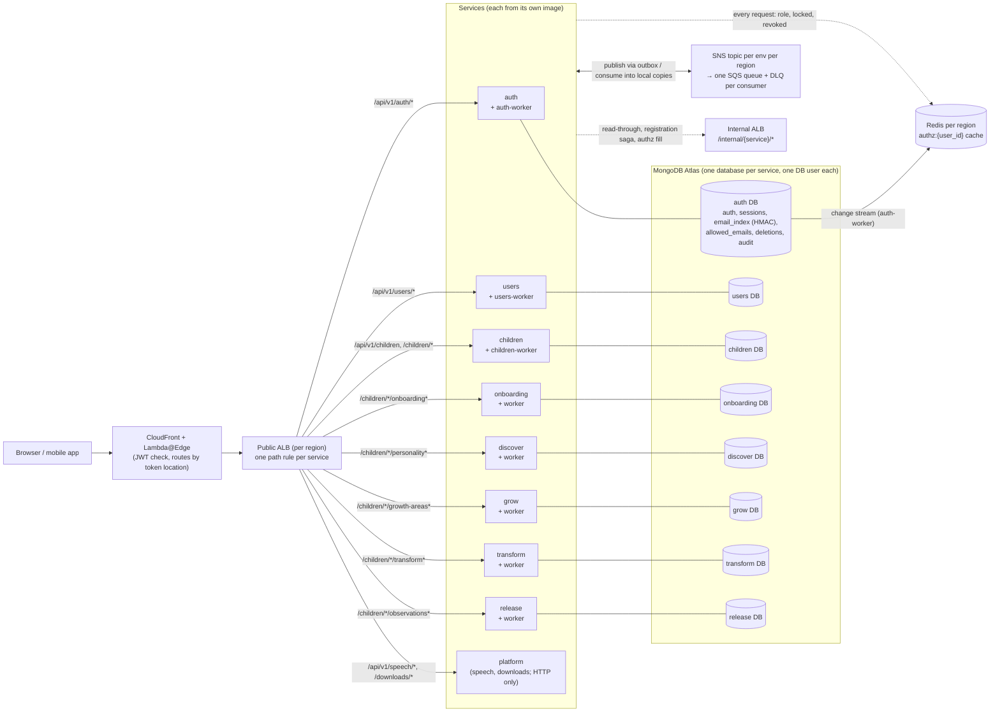
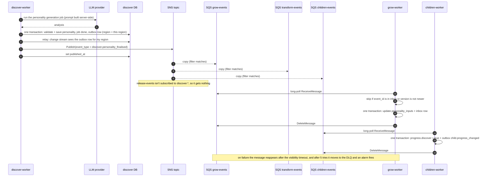
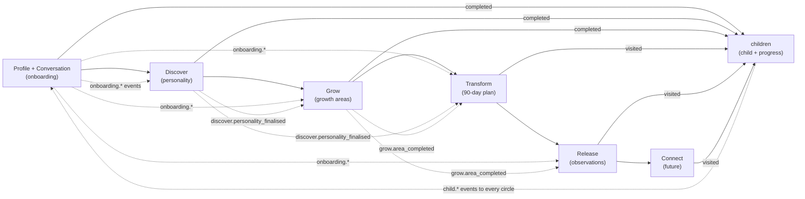
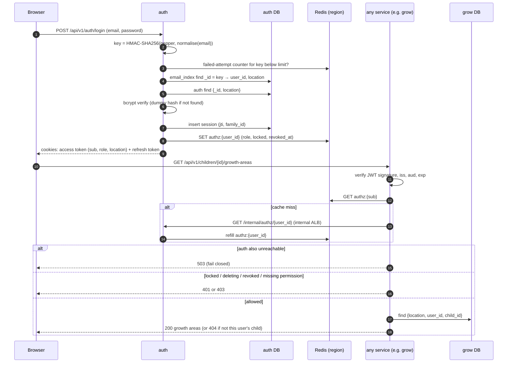
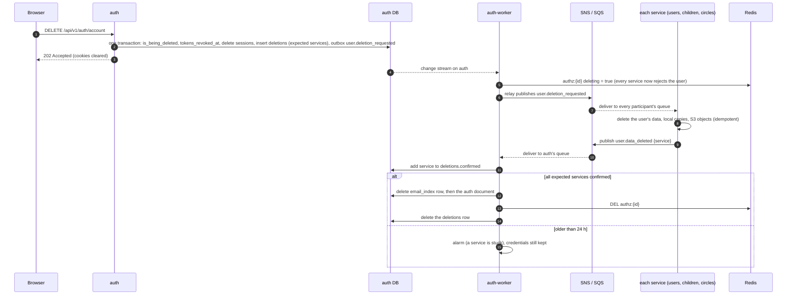

# Service split: auth, users and the journey circles

**Status:** proposal, 2026-10-22. Decisions taken (section 17); nothing is implemented yet.
**Greenfield:** no environment holds real data yet, so there is **no data migration**. Every database starts empty, and the services are built directly in their final shape (section 16).
**Scope:** split the single backend into services that each own their code and their database. That covers authentication, the user profile, the child, each journey circle and a stateless platform service. Cross-service data moves by **events into local copies**. Everything is ready for an Atlas Global Cluster later.

Related: [jwt-keys.md](jwt-keys.md), [infra-operations.md](infra-operations.md#adding-a-backend-service), [getting-started.md](getting-started.md), [production-readiness-review.md](production-readiness-review.md) (DB-01 database plan, DB-02 connection budget, EDGE-01 global login).

---

## 1. Starting point: the current code

The code below exists, but nothing it has written needs to be kept. This section is only what the new design replaces.

| Area | Today |
|---|---|
| Code | One FastAPI app. `APP_COMPONENT` (`auth` / `admin` / `api` / `worker`) picks which routers a task mounts, but all components share every module and **one database**. |
| User data | One `users` document holds both credentials and profile: `email`, `password_hash`, `full_name`, `role`, `country_code`, `location`, `preferences {tts_enabled, last_visited_path}`, `is_locked`, `tokens_revoked_at`, `is_being_deleted`, `created_at`, `updated_at`. |
| Child data | One `children` document mixes the child (name, age, gender, school, avatar) with **onboarding** answers and traits, the **discover** AI personality (`personality`, `pending_personality_vm`), seven journey progress flags and the jobs lock (`active_jobs`). |
| Circle data | `growth_areas` (grow), `ninety_day_plans` (transform: main page, tracking, 3-month plan in one document), `observations` (release), `jobs` (all AI generation). |
| AI prompts | **Built in the browser** (`ninetyDayPlanPrompt.ts`, `growthQuestionsPrompt.ts`, `lifePathwayPrompt.ts`, …) and sent to `/llm/invoke` or `/jobs`. A signed-in user can send any prompt, at your cost. |
| Ids | `_id` is a **UUIDv4 string** (`str(uuid.uuid4())`). Every other collection stores it as `user_id`. |
| Email uniqueness and login | `email_index` (unsharded): `_id` = **plaintext email**, `user_id`, `location`. Login is a point read there, then `users.find_one({_id, location})`. |
| Sessions | `sessions`: `_id` = refresh-token `jti`, `user_id`, `location`, `expires_at`, swept by a background task. |
| Per-request check | `deps.get_current_user` reads `users` **on every request** (exists, `is_locked`, `tokens_revoked_at` vs `iat`, `role`). |
| Admin | A separate ECS service under `/api/v1/admin/*`. An admin is a `users` document with `role: "admin"`, promoted by hand in mongosh ([getting-started.md](getting-started.md)). |
| Account deletion | `DELETE /api/v1/user/me` deletes from seven collections directly. It doesn't delete the user's `jobs` or their S3 uploads. |
| `last_visited_path` | Written on every navigation by both frontends, **never read back**. |
| Secrets | One `backend-secrets` JSON and **one shared ECS execution role**, which can read every key. |
| Email in logs | `sha256(email)[:16]`: unkeyed, so it can be matched against a list of candidate emails. |

### How the circles depend on each other

The seven circles are separate screens, but their AI generation reads earlier circles' data, and each unlocks only after the previous one:

| Circle | Its generation reads | Today's code |
|---|---|---|
| Discover (personality) | Onboarding answers and traits | `PersonalityJourney.tsx` |
| Grow (questions, life pathway, recommendations) | Personality traits, onboarding `strengths` / `hobbies`, growth answers | `growthQuestionsPrompt.ts`, `lifePathwayPrompt.ts`, `GrowthAreas.tsx` |
| Transform (90-day plan, tracker) | Onboarding/discover `strengths`, growth data | `ninetyDayPlanPrompt.ts` |
| Release (observations) | Onboarding answers, growth answers | `observationsData.ts` |
| All | The progress chain: profile → conversation → discover → grow → transform → release → connect | `children.py` (`mark_journey_progress`) |

These dependencies are why cross-service data moves by events into **local copies** (section 7), not by calls between services at request time.

---

## 2. Target shape

| Service | Owns | Runtimes (ECS services) |
|---|---|---|
| **auth** | Credentials, roles, sessions, email lookup, allow-list | `auth` (HTTP), `auth-worker` (authz change stream, sagas, outbox relay, reaper) |
| **users** | User profile: names, address, preferences | `users`, `users-worker` (outbox relay, deletion events) |
| **children** | The child (name, age, gender, school, avatar) and **journey progress** | `children`, `children-worker` (events) |
| **onboarding** | Profile circle and conversational onboarding: answers, traits | `onboarding`, `onboarding-worker` (generation, events) |
| **discover** | AI personality | `discover`, `discover-worker` |
| **grow** | Growth areas: questions, answers, recommendations, child activity, life pathway | `grow`, `grow-worker` |
| **transform** | 90-day plan: main page, tracking, 3-month plan, event, photos | `transform`, `transform-worker` |
| **release** | Observations | `release`, `release-worker` |
| **connect** | Connect circle (future) | `connect`, `connect-worker` (when built) |
| **platform** | Stateless shared capabilities: speech-to-text (voice input is used by several circles) and app downloads. **No database.** | `platform` |

The `-worker` runtimes come from the same image as their service. They run AI generation, the outbox relay and event consumers, so slow LLM work never competes with page requests. Every service that owns data has one, because it must at least relay its own events and handle `user.deletion_requested`. Platform, which owns no data, doesn't.



Labelled arrows from the public ALB are request routes (section 13.1). Plain lines to the databases show that each service uses only its own. The two-way arrow is events (section 7). Dotted arrows are the per-request authz check (9.3) and the internal calls (13.2).

### Ownership rules

- **A service never reads or writes another service's database.** For data it needs from elsewhere, it keeps a **local copy** fed by events. It calls another service's internal API only on a cache miss or a synchronous step of a saga.
- **One Atlas database user per service**, with access to its own database only.
- **One Secrets Manager secret and one ECS execution role per service** (section 15.1). Only auth can read the JWT private key and the HMAC pepper. Only generating workers and platform (speech-to-text) get LLM provider keys.
- **Services import only `common`**, never each other. CI enforces this with `import-linter`.

---

## 3. User and child ids — **decided: UUIDv4 strings**

`sub` in the token, `_id` in `auth` and `users`, and `user_id` everywhere else are the **same UUIDv4 string**, created by auth at registration. Children get UUIDv4 `child_id`s from the children service.

Why not `ObjectId`:
- **Hot spot:** with the `{location, _id}` shard key, an increasing `ObjectId` puts every new document in a zone into that zone's last chunk. Random UUIDs spread the inserts.
- **Less change:** the current ids, code and tests already use UUID strings.
- **No timestamp leak:** an `ObjectId`'s first 4 bytes are its creation time.

---

## 4. Conventions for every database

- **Shard-key-ready:** every per-user or per-child collection has `location` and a unique `{location: 1, _id: 1}` index, ready for Atlas Global Writes (section 14).
- **Validators:** each collection gets a `$jsonSchema` validator, so a buggy writer can't store a malformed document.
- **Timestamps:** MongoDB doesn't generate `created_at` / `updated_at`. The owning service sets them on insert and on every write.
- **`schema_version`** (int) on every document. Code can then handle old and new shapes side by side when a schema changes.
- **Per-child documents carry `user_id`, `child_id` and `location`.** A query filtered by all three returns nothing for someone else's child, so ownership checks cost no extra read (section 12.3).
- **Every service with events** has `outbox` and `inbox` collections (section 7.3), and every generating service a `jobs` collection (section 8).

---

## 5. Auth and users

### 5.1 `auth.auth` — credentials, role and account state

| Field | Type | Required | Notes |
|---|---|---|---|
| `_id` | string (UUIDv4) | ✅ | The user id; `sub` in every token |
| `email` | string | ✅ | Normalised (6.3). Plaintext, but only here, in the user's own zone. **The only place a user's email is stored.** |
| `password_hash` | string | ✅ | bcrypt, cost 12, as today. Google sign-ups get a random unusable password hashed the same way. |
| `role` | enum `parent` / `admin` | ✅ | **The single source of truth for roles** (section 11) |
| `country_code` | string (ISO 3166-1 alpha-2) | ✅ | Validated against `COUNTRY_TO_REGION` / `BLOCKED_COUNTRIES` |
| `location` | string | ✅ | From `resolve_region(country_code)`. **Immutable**: moving a user means moving their documents, not updating a field. |
| `auth_provider` | enum `password` / `google` | ✅ | |
| `tokens_revoked_at` | date \| null | — | Tokens issued at or before it are rejected |
| `is_locked` | bool | — | Admin lock |
| `is_being_deleted` | bool | — | Set at the start of deletion (section 10) |
| `created_at`, `updated_at`, `schema_version` | | ✅ | |

### 5.2 Other `auth` collections

| Collection | Fields |
|---|---|
| `sessions` | `_id` (refresh `jti`), `user_id`, `location`, `family_id` (rotation chain, 9.1), `expires_at`, `created_at` |
| `email_index` | `_id` = `HMAC-SHA256(pepper, normalised_email)` hex, `key_version`, `user_id`, `location`, `status` (`reserved` / `active`), `reserved_at` |
| `allowed_emails` | `_id` = HMAC hex, `key_version`, `email_hint` (masked, e.g. `j***@example.com`), `added_by`, `created_at` |
| `deletions` | One per user deletion in progress: `_id` = user id, `requested_at`, `expected` (services that must confirm), `confirmed` (those that have) (section 10) |
| `audit` | Privileged-action events from auth (section 11.3) |

### 5.3 `users.users` — profile

| Field | Type | Required | Notes |
|---|---|---|---|
| `_id` | string (UUIDv4) | ✅ | Same as `auth._id` |
| `first_name` | string | ✅ | |
| `middle_name`, `last_name` | string | — | |
| `location` | string | ✅ | Same as in `auth`; immutable |
| `preferences.tts_enabled` | bool | ✅ | Default `true` |
| `address_line_one` / `_two` / `_three` | string | — | Personal data: export, deletion, never logged |
| `created_at`, `updated_at`, `schema_version` | | ✅ | |

**Deliberately absent:**
- **`email`:** auth holds it. A service that needs it calls auth's internal API.
- **`full_name`:** it's gone from storage, APIs and tokens. Code that needs a display name uses `common.names.full_name(first, middle, last)`, which joins the non-empty parts with single spaces.
- **`last_visited_path`:** it's written but never read today. Remove it, along with its writes in `frontend/src/lib/AuthContext.tsx`, `frontend/src/hooks/useStartOver.ts` and the same two files in `frontend-app/`.

---

## 6. Email lookup with HMAC — **decided**

### 6.1 What it is

A collection that isn't sharded sits in **one** region of the Global Cluster. Storing plaintext emails there would put every user's email in that region, whatever zone the user is in. Instead, `email_index` and `allowed_emails` are keyed by a **keyed hash**:

```text
normalised = lowercase(trim(email))                 # "  Jane.Doe@Example.com " → "jane.doe@example.com"
key        = HMAC-SHA256(pepper, normalised)        # 64 hex chars
email_index: { _id: key, key_version: 1, user_id, location, status }
```

- The same email and the same pepper always give the same key, so lookup and uniqueness work exactly as before.
- Without the pepper, the key reveals nothing and can't be recomputed.

### 6.2 Why HMAC and not a plain hash

| Key | Can someone with a copy of `email_index` find out the emails? |
|---|---|
| Plaintext email | Yes, they're right there. |
| `sha256(email)`, unkeyed | **Yes, easily.** Emails are guessable: hash a list of candidates (marketing lists, breach dumps, `firstname.lastname@company` patterns) and compare, at billions of hashes per second. |
| `HMAC-SHA256(pepper, email)` | **No**, not without the pepper. |
| bcrypt/argon2 of the email | Also safe, but deliberately slow (about 250 ms per check), and a per-row salt would break lookup |

### 6.3 How it's used

| Operation | Steps |
|---|---|
| Register | Normalise → HMAC → insert `email_index {status: reserved}`. A duplicate key means the email is taken. |
| Login | Normalise → HMAC → `email_index` → `{user_id, location}` → targeted read of `auth.auth` |
| Allow-list check | Normalise → HMAC → `allowed_emails` point read |
| Find an account by email (admin) | Normalise → HMAC → `email_index` → `auth.auth` |
| Logs | Log `key[:16]` instead of today's unkeyed `sha256(email)[:16]` |

**Normalisation must be identical everywhere:** one function, `common.emails.normalise()`, which trims and lower-cases and nothing else. No Gmail dot or `+tag` stripping, because that changes which mailbox the address means. Any difference between code paths silently creates duplicate accounts.

### 6.4 The pepper

- **What:** 32 random bytes (`openssl rand -hex 32`).
- **Where:** a Secrets Manager secret that **only auth** can read, one per environment, and not in the database, tfvars or GitHub variables.
- **The same in every region of an environment**, because lookups are global.
- **Losing it** makes every key unmatchable. Back it up with the other environment secrets.

### 6.5 Rotating the pepper

1. Add pepper **v2** next to **v1**. Auth looks up v2 first, then falls back to v1.
2. **Re-key:** a one-off job reads each `auth.auth` document (which has the plaintext email), inserts a v2 `email_index` row and deletes the v1 row.
3. When no v1 rows remain, remove v1.

`allowed_emails` holds no plaintext, so it can't be re-keyed. Keep v1 lookups until outstanding entries are used, or have admins re-add them.

### 6.6 What it doesn't protect

- **`auth.auth.email`:** plaintext, but in the user's own zone, and needed to show the address and contact the user.
- **A compromised auth task:** it can compute keys. Least privilege limits this to one service.

---

## 7. Events and local copies

### 7.1 Why

Each circle needs a few fields from earlier circles, and every service needs to know which children belong to whom. Calling the owner on every request would couple services at runtime: a grow outage would break transform's page. Instead:
- **Owners publish an event** whenever data that others rely on changes.
- **Consumers keep a local copy** of only the fields they need, in their own database.
- **Pages and generation read local data only.**

### 7.2 Transport: SNS + SQS per region

| Piece | Choice |
|---|---|
| Bus | One **SNS topic per environment per region** (`{app}-{env}-events`) |
| Per consumer | One **SQS queue per consuming service**, subscribed with a **filter policy** on `event_type`, plus a dead-letter queue (DLQ) after 5 failed attempts |
| Ordering | Not guaranteed (standard SNS/SQS). Consumers handle it with versions (7.4). |
| Region | Events are published and consumed in the region that handled the write. MongoDB is global, so the local copies a consumer writes are global too. Only Redis is regional, and it's fed by the change stream (9.3). |
| Why not EventBridge or Kafka (MSK) | SNS+SQS is the simplest managed fan-out with per-consumer retries and DLQs. EventBridge adds routing features this design doesn't need. **MSK** charges for brokers by the hour: about $66 a month for the smallest 2-broker cluster, about $460 for 3 × `m5.large`, per region. So it's far more expensive until roughly 10M–100M monthly active users. It also has no built-in DLQ or filtering; its advantages are replay and per-partition ordering. Revisit it above about 1,000 events per second. `common.events` keeps the transport swappable. |

### 7.3 Reliable publishing: the outbox

A service must never save a change and then fail to publish its event, or the reverse.
1. **One transaction, one database:** the change and an `outbox` document `{_id: event_id, event_type, payload, aggregate_id, version, region, created_at, published_at: null}` are written together. `region` is the AWS region of the task that handled the request.
2. **The relay** in the service's worker watches `outbox` (change stream, with a polling fallback), publishes to SNS and sets `published_at`. On a crash it publishes again, so delivery is **at least once**.
   - **Each region's relay handles only rows with its own `region`** (in the change-stream filter and the polling query). MongoDB is global, so without that filter every region's relay would see every region's outbox writes and publish each event once per region.
   - If a region is down, its unpublished rows wait. An operator can let another region's relay take them over by changing their `region`.
3. **`outbox` has a TTL index** on `published_at`: rows are deleted 7 days after publishing.

Consumers make duplicates harmless:
- **`inbox`:** `{_id: event_id, processed_at}`, written in the same transaction as the consumer's update. An event already in `inbox` is acknowledged and skipped.
- **TTL** of 15 days, longer than SQS's maximum message retention (14 days), so a redelivered message is always recognised.

### 7.4 Versions and ordering

- Every event carries the owner's **`version`** for that record: a counter incremented on every write.
- A consumer applies an event only if its `version` is higher than the one stored on its local copy. Older or duplicate events are ignored.
- **Tombstones:** a deletion event carries the final version too, so a late update can't resurrect deleted data.

**One event, end to end** (discover finishes a personality; grow, transform and children need it):



### 7.5 Cache misses: read-through

A local copy can lag by a second, for example right after a child is created, when its onboarding page opens before `child.created` has arrived. When a needed local copy is missing:
1. The service calls the owner's internal API once (`GET /internal/children/{id}`, …).
2. It stores the result with the owner's `version`.
3. It continues. Later events with higher versions overwrite it.

This keeps the user experience immediate while events stay the normal path.

### 7.6 Event catalogue

| Event | Producer | Payload (beyond ids, `location`, `version`) | Consumers |
|---|---|---|---|
| `user.deletion_requested` | auth | — | every service holding user data |
| `user.data_deleted` | each service | `service` | auth (deletion saga) |
| `user.role_changed` | auth | `role` | audit, notifications |
| `user.profile_updated` | users | `first_name`, `middle_name`, `last_name` | connect (display names) |
| `child.created`, `child.updated` | children | `user_id`, `name`, `age`, `gender`, `school` | onboarding, discover, grow, transform, release, connect |
| `child.deleted` | children | `user_id` | every circle (delete that child's data) |
| `child.progress_changed` | children | the seven progress flags | every circle (unlock checks, 12.4) |
| `onboarding.profile_completed`, `onboarding.answers_updated` | onboarding | `strengths`, `hobbies`, `thinking_pattern`, `communication_style`, `energy_level`, `social_behaviour`, `emotional_behaviour`, `concerns` | discover, grow, transform, release; children (progress) |
| `onboarding.conversation_completed` | onboarding | — | children (progress), discover |
| `discover.personality_finalised` | discover | `traits` (summary), `strengths` | grow, transform; children (progress) |
| `grow.area_completed`, `grow.area_updated` | grow | `area_id`, `area_name`, answer summary, recommendations | transform, release |
| `grow.completed` | grow | — | children (progress) |
| `transform.visited`, `release.visited`, `connect.visited` | each | — | children (progress) |

**Payloads carry only what consumers need.** Each payload field is someone's local copy, so fewer fields means less duplicated personal data.

### 7.7 Local copies, service by service

| Service | Local copies (collection) | From |
|---|---|---|
| every circle | `child_access {child_id, user_id, location, name, age, gender, is_deleted, progress}` | `child.*` |
| discover | `onboarding_inputs` | `onboarding.*` |
| grow | `onboarding_inputs`, `personality_inputs` | `onboarding.*`, `discover.*` |
| transform | `onboarding_inputs`, `personality_inputs`, `growth_inputs` | `onboarding.*`, `discover.*`, `grow.*` |
| release | `onboarding_inputs`, `growth_inputs` | `onboarding.*`, `grow.*` |
| children | (none; it owns progress and consumes completion events) | |

Local copies:
- are **read-only** for the consumer;
- are **deleted** on `child.deleted` and `user.deletion_requested`;
- follow the same encryption and retention rules as the source.

**How the circles feed each other:**



Solid arrows between circles are the order a parent goes through them. Dotted arrows are events feeding each circle's local copies. Arrows into children are progress updates (12.4). Children's `child.*` events go to every circle; only one arrow is drawn to keep the diagram readable.

### 7.8 Contracts

- Event schemas live in `backend/common/events/schemas/` as versioned JSON Schema, e.g. `child.updated.v1.json`.
- A **contract test** in CI checks that every producer emits valid payloads, and that every consumer handles every schema it subscribes to.
- **Changes are additive only:** add optional fields. A breaking change is a new event version (`.v2`) published alongside the old one until every consumer moves.
- This matters because deploys roll services out **in parallel**, so producers and consumers run different versions for a while.

---

## 8. AI generation

**Each circle owns its generation:** job types, prompt building, LLM calls and storing results all happen in its own service, in its own database.

| Today | New |
|---|---|
| The browser builds prompts and posts them to `/llm/invoke` or `/jobs` | The browser asks for a result: `POST /api/v1/children/{id}/personality/generation`. The **server** builds the prompt from its own data plus its local copies. |
| One shared `jobs` collection with a write-back allow-list into other collections | A `jobs` collection **per generating service**. A job can write only to its own service's collections. |
| `active_jobs` lock on the child document | An `active` field on the circle's own document (one job per type per child) |

Shared code in `common.generation`:
- the job model and queue (stored in the calling service's database);
- the LLM provider client and timeouts;
- the **per-user LLM rate limit in Redis** (keyed by `user_id`), so the hourly limit applies across every circle, not per service;
- a prompt-template helper.

Results the client used to "finalise" (for example `pending_personality_vm` → `personality.view_model`) are now validated and promoted **by the server** when the job completes. That removes the client's ability to save arbitrary JSON into those fields.

**`/llm/invoke` is removed.** Nothing sends raw prompts to the backend.

**LLM keys** are injected only into the workers of services that generate (onboarding, discover, grow, transform and release), plus platform, whose speech-to-text uses OpenAI (`OPENAI_API_KEY`), as `/audio/transcribe` does today.

**Removing `/llm/invoke` breaks no live page.** Its only synchronous callers are `RecommendationsPhase.tsx` and `ChildActivityGame.tsx`, and neither is rendered: nothing imports `RecommendationsPhase`, and `ChildActivityGame` is used only by it. Delete both components along with the endpoint.

---

## 9. Login, tokens and per-request authorization

### 9.1 Login and sessions

1. Normalise and HMAC the email, then read `email_index`. If there's no `active` row, run a dummy bcrypt check (timing-safe) and return 401.
2. Read `auth.auth` with `{_id, location}`, a targeted single-zone read.
3. If `is_being_deleted` or `is_locked`, run the dummy check and return 401/403.
4. **Throttle by email key:** after 5 failures in 15 min for an HMAC key, reject further attempts for 15 min. Counters live in Redis, as well as today's per-IP limits.
5. Verify the password, issue tokens, create a `sessions` row with a new `family_id`, and warm the authz cache.

**Refresh-token rotation with reuse detection:**
- Each refresh issues a new refresh token in the same `family_id` and deletes the old session.
- If an already-used refresh token is presented again, it was stolen: revoke the whole family, and set `tokens_revoked_at`.

Login runs in the bootstrap region (edge PURE_BYPASS); step 2 may be one cross-region read.

### 9.2 Claims

| Claim | Access | Refresh | Notes |
|---|---|---|---|
| `iss`, `aud`, `iat`, `exp`, `type` | ✅ | ✅ | As today; access 30 min, refresh 24 h |
| `sub` | ✅ | ✅ | The user id |
| `location` | ✅ | ✅ | The edge routes on it; services use it for targeted queries |
| `role` | ✅ | — | For cheap coarse checks only; the cached role is authoritative (9.3) |
| `jti`, `family_id` | — | ✅ | |
| `email`, names | ❌ | ❌ | A JWT is signed, not encrypted: anyone holding the cookie can read it |

### 9.3 Per-request checks and the authz cache

A valid token isn't enough. Within its lifetime an admin can lock the account, the user can log out everywhere, deletion can start or the role can change. Every service therefore checks a **per-region Redis cache**:

```text
authz:{user_id} → {"role":"parent","locked":false,"deleting":false,"revoked_at":1792500000}
TTL 25 h
```

1. Verify the JWT.
2. `GET authz:{sub}`.
   - On a hit, use it.
   - On a miss, call auth's `GET /internal/authz/{user_id}`, which reads `auth.auth` and refills Redis.
3. Reject:
   - `deleting` → 401;
   - `locked` → 403;
   - `revoked_at >= iat` → 401;
   - a missing permission for the cached role → 403 (section 11).
4. **Fail closed — decided:** if the entry is missing and auth is unreachable, return **503**.

**Keeping it current:**
- **Change stream:** an `auth-worker` in each region watches `auth.auth` for users whose `location` maps to that region, and updates that region's Redis. It stores a resume token, and needs a dedicated Atlas cluster (M10+).
- **Eviction:** the default `volatile-lru` can evict entries. That's safe, because a miss refills.
- **Redis RBAC users:** every service can read `authz:*`; only `auth` and `auth-worker` can write.

**Login, then a later request:**



---

## 10. Sagas

### 10.1 Registration

1. **Check:** the email's HMAC is in `allowed_emails`, the country isn't blocked, and the password policy is met. Resolve `location`.
2. **Reserve:** `email_index {_id: HMAC, user_id: <new uuid>, location, status: reserved, reserved_at}`. A duplicate on an `active` row returns 409; a stale `reserved` row (15 min) is reclaimed.
3. **Credentials:** insert `auth.auth` (`role: parent`, `auth_provider`).
4. **Profile:** call users' `PUT /internal/users/{user_id}` with names, `location` and address (an upsert, so retries are harmless). **No email.**
5. **Activate:** `email_index.status = active`.
6. **Sign in:** tokens, session, authz cache.

**Failure handling:**
- Steps 3–4 failing are undone in reverse order.
- The `auth-worker` reaper cleans up `reserved` rows older than 15 min.
- Login requires an `active` row, so a half-made user can't log in.

**Google sign-up** is the same, with `auth_provider = google`: `given_name` → `first_name` and `family_name` → `last_name`, falling back to the email's local part.

### 10.2 Child deletion

`DELETE /api/v1/children/{id}`:
1. The children service soft-deletes the child and publishes `child.deleted`.
2. Each circle deletes its data for that child, plus its S3 objects (avatar, plan photos), and drops the child from its `child_access` copy.
3. A purge job hard-deletes the child after the soft-delete window.

### 10.3 Account deletion

`DELETE /api/v1/auth/account`:
1. **Start (synchronous):**
   - Auth sets `is_being_deleted = true` and `tokens_revoked_at = now`.
   - It deletes sessions and clears cookies.
   - It inserts `deletions {_id: user_id, expected: [users, children, onboarding, discover, grow, transform, release], confirmed: []}` (plus `connect` once it exists) and an outbox event `user.deletion_requested`, in one transaction.
   - It returns **202**.
   - The authz cache flips to `deleting`, so every service rejects the user from now on.
2. **Each service deletes** everything it holds for that user, including local copies and S3 objects. It then publishes `user.data_deleted {service}`. Deleting twice is a no-op, so this is idempotent.
3. **`auth-worker`** records each confirmation in `deletions.confirmed`. When `confirmed ⊇ expected`, it deletes `email_index`, then `auth.auth`, then `authz:{id}`, then the `deletions` row.
4. **Alert** on any deletion older than 24 h, which points to a stuck service. **Credentials are always deleted last**, so a stuck deletion can't be logged into, and can still be resumed.



The `expected` list comes from one place, `common.deletion.PARTICIPANTS`. A test fails if a service with user data isn't on it.

**Admins:** auth refuses to delete, demote or lock the **last** active admin.

---

## 11. Authorization: resource URLs and permission checks

### 11.1 No role names in URLs

URLs name **resources**; permission checks decide **who** may act on them. There's no `/admin/` path anywhere. An admin uses the same resource endpoints as everyone else, and some permissions are held only by admins.

| Resource | Endpoint | Permission |
|---|---|---|
| Own account | `GET /api/v1/auth/me`, `DELETE /api/v1/auth/account` | signed in |
| Accounts (list, find by email) | `GET /api/v1/auth/accounts`, `GET /api/v1/auth/accounts?email=…` | `accounts:list` |
| Lock, unlock | `POST /api/v1/auth/accounts/{id}/lock`, `…/unlock` | `accounts:lock` |
| Role | `PATCH /api/v1/auth/accounts/{id}/role` | `accounts:role` |
| Allow-list | `GET/POST/DELETE /api/v1/auth/allowed-emails…` | `allowed_emails:read` / `:write` |
| Profile, preferences | `GET/PATCH /api/v1/users/{user_id}/profile`, `…/preferences` (`{user_id}` may be `me`) | self, or `profiles:read:any` / `profiles:write:any` |
| Children | `GET /api/v1/children`, `POST /api/v1/children`, `GET/PATCH/DELETE /api/v1/children/{id}` | own children, or `children:read:any` |
| Circle data | `/api/v1/children/{id}/onboarding`, `/personality`, `/growth-areas…`, `/transform…`, `/observations` | own child, or `children:read:any` |

### 11.2 How checks work

FastAPI **dependencies** (`Depends`), not Python decorators. Dependencies work with FastAPI's injection and show up in the OpenAPI docs.

- **`require("accounts:lock")`:** passes if the caller's cached role grants that permission.
- **`require_self_or("profiles:read:any")`:** passes for the resource's owner, or for a holder of the wider permission. Anyone else gets **404**, not 403, so ids can't be probed.
- **One permission table in `common.permissions`:** `parent` → its `:self` permissions; `admin` → all. Changing what a role may do means editing that table, never touching routes.
- **Deny by default:**
  - every service uses a router that refuses to register a route without a policy;
  - a test walks `app.routes` and fails if any route lacks one;
  - public routes (login, register, health) declare `public`.

### 11.3 Audit

The permission check is the single place every request passes, so it writes the audit trail:

| Field | Meaning |
|---|---|
| `actor_id`, `actor_role` | Who called |
| `permission` | e.g. `accounts:lock` |
| `subject_id` | Whose data (account, profile or child owner) |
| `privileged` | `true` when the access was allowed only because of the role, i.e. actor ≠ owner, or an admin-only permission |
| `outcome` | allowed / denied, status code |
| `request_id`, source IP (`CloudFront-Viewer-Address`), route, changed field **names** (never values) | Context |

- **Where:** every `privileged: true` event and every denial goes to a dedicated audit stream (a CloudWatch log group with long retention), and auth's to its `audit` collection as well.
- **Alarms:** privileged actions per admin per hour, denied privileged attempts, and any role change.
- **Optional extra:** admin-only permissions can also require a source-IP range or MFA in the same check. That replaces the path-based restriction `/admin/*` would have allowed.

### 11.4 Admins

- An admin is an ordinary account with `role: "admin"` and a normal profile.
- **First admin:** a `backend/tools/promote-admin` command that runs once per environment, refuses if an admin already exists, and writes an audit event.
- **Later admins:** promoted with `PATCH /api/v1/auth/accounts/{id}/role` by an existing admin.

---

## 12. Circle services

### 12.1 Data owned by each

| Service | Database: collections | Main fields (from today's `children`, `growth_areas`, …) |
|---|---|---|
| children | `children`: `children`, `outbox`, `inbox` | `_id` (child id), `user_id`, `location`, `name`, `age`, `gender`, `school`, `avatar_id`, `avatar_key` (S3), `progress {profile, conversation, discover, grow, transform, release, connect}`, `is_deleted`, `deleted_at`, `version` |
| onboarding | `onboarding`: `profiles`, `conversations`, `jobs`, `child_access`, `outbox`, `inbox` | `onboarding_phase`, `current_phase`, `strengths`, `hobbies`, `thinking_pattern`, `communication_style`, `energy_level`, `social_behaviour`, `emotional_behaviour`, conversational answers |
| discover | `discover`: `personalities`, `jobs`, `child_access`, `onboarding_inputs`, `outbox`, `inbox` | `view_model`, raw analysis, status (`pending` / `ready`), `finalised_at` |
| grow | `grow`: `growth_areas`, `jobs`, `child_access`, `onboarding_inputs`, `personality_inputs`, `outbox`, `inbox` | Per area: answers, `parent_questions`, `child_rounds`, recommendations, child activity, `life_pathway_milestones`, status |
| transform | `transform`: `plans`, `jobs`, `child_access`, `onboarding_inputs`, `personality_inputs`, `growth_inputs`, `outbox`, `inbox` | **One document per child:** `ask`, `plan` (main page and 3-month plan), `track_steps`, `track_done`, `track_inputs`, `track_sittings`, `applied`, `act_inputs`, `act_counts`, `feedback`, `event_name`, `event_date`, `photos` (S3 keys) |
| release | `release`: `observations`, `jobs`, `child_access`, `onboarding_inputs`, `growth_inputs`, `outbox`, `inbox` | `source`, `items`, `watching`, `span`, `started_at` |
| connect | `connect` (when built) | TBD |

Two changes from today:
- **Discover's AI personality leaves the child document**, so onboarding stores only answers and traits. Discover can still start generating the moment onboarding completes (on `onboarding.profile_completed`), so its page opens instantly, but the result is stored in discover's own database.
- **Transform stays one document per child.** Its sections load together, and targeted `$set`s update one section at a time. Split a section out only if it grows large or another page needs it on its own.

### 12.2 One request per page, one read per stage

| Page | Endpoint | Service | Database reads |
|---|---|---|---|
| Home (children and progress) | `GET /api/v1/children` | children | 1 query |
| Onboarding | `GET /api/v1/children/{id}/onboarding` | onboarding | 1 (`profiles`; child name from `child_access` in the same database) |
| Discover | `GET /api/v1/children/{id}/personality` | discover | 1–2 |
| Grow, Life Pathway | `GET /api/v1/children/{id}/growth-areas` | grow | 1 query |
| Transform | `GET /api/v1/children/{id}/transform` | transform | 1 (the whole plan document) |
| Release | `GET /api/v1/children/{id}/observations` | release | 1 |

Pages no longer gather other circles' data, because generation happens server-side (section 8).

### 12.3 Ownership without an extra read

- Each circle's documents carry `user_id`, `child_id` and `location`. A query filtered by all three returns nothing for someone else's child, which gives a 404.
- `child_access` (7.7) covers what the circle's own documents can't: whether a child exists before the circle has created anything for it, and whether it's soft-deleted.

### 12.4 Unlocking circles

- **Owner:** children owns progress, set by completion events (`discover.personality_finalised` → `discover`, `grow.completed` → `grow`, …).
- **Checks:** each circle checks its unlock condition against `child.progress_changed` in its own `child_access` copy (e.g. grow requires `discover`), with read-through on a miss (7.5).
- **Rule:** one-way and in order, exactly as `mark_journey_progress` enforces today.
- **"Visited" circles** (transform, release, connect): the page calls `POST /api/v1/children/{id}/<circle>/visit` once, on its circle service, which publishes `<circle>.visited`. A `GET` never has that side effect. This replaces today's `POST /children/{id}/progress/{flag}` for those three flags.

---

## 13. Routing, internal calls and the platform service

### 13.1 ALB path rules

Circle endpoints sit under `/api/v1/children/{id}/…`, and ALB path patterns accept `*` in the middle. Specific rules come first, and the children service is last among the child paths:

| Priority | Service | Path patterns |
|---|---|---|
| 10 | onboarding | `/api/v1/children/*/onboarding*` |
| 20 | discover | `/api/v1/children/*/personality*` |
| 30 | grow | `/api/v1/children/*/growth-areas*` |
| 40 | transform | `/api/v1/children/*/transform*` |
| 50 | release | `/api/v1/children/*/observations*` |
| 60 | connect | `/api/v1/children/*/connect*` (when built) |
| 100 | children | `/api/v1/children`, `/api/v1/children/*` |
| 110 | users | `/api/v1/users/*` |
| 120 | auth | `/api/v1/auth/*` |
| 130 | platform | `/api/v1/speech/*`, `/api/v1/downloads/*` |
| 50000 | — | fixed 404 (no catch-all service) |

Notes:
- **Generation and job status** for a circle sit under that circle's path (`/api/v1/children/{id}/personality/generation`, `…/generation/{job_id}`), so they route with it.
- **Condition values:** every rule has at most 2 patterns + 2 origin-verify values, under AWS's limit of 5. There are 10 rules, far below the ALB's 100.
- **`modules/alb`:** it needs two changes:
  - allow **no catch-all target**, with a fixed-response default instead;
  - allow `*` mid-path, which ALB supports. The module's `path_patterns` already pass any string.
- **Tests:** a test in each service checks its route paths against these patterns, as `test_main.py` does today.

### 13.2 Internal calls

Internal endpoints live under `/internal/*`, on a separate port. **The public ALB never routes them**; only the internal ALB below does. They're used only for read-through (7.5), the registration saga and the authz fill.
- **Transport: one internal ALB per environment per region,** not ECS Service Connect.
  - The ALB is internal (private subnets, no public address), at a private DNS name such as `internal.{app}-{env}.{region}`, with one path rule per service: `/internal/children/*` → children's internal target group, and so on.
  - **Why not Service Connect:** it adds an Envoy proxy container to every task, and AWS recommends reserving about 256 CPU / 64 MiB for it. That doesn't fit the agreed 256 / 512 tasks in dev and sbx: they'd have to double in size (about +$160 a month per region). In prod it would reserve a quarter vCPU in every one of dozens of tasks. An internal ALB costs about **$17 a month per environment per region** plus a little LCU, needs no sidecar, and is a pattern `modules/alb` already implements.
- **Network:** the internal ALB's security group admits traffic only from the services' task security groups. Each service's task security group admits its internal port only from the internal ALB.
- **Identity:** a short-lived **service token** (JWT, `aud = "<service>-internal"`, `sub = "<caller>"`), minted with a separate key.
- **Tracing:** every internal call and every event carries the W3C `traceparent` header and `X-Request-Id`, so one user action can be followed across services (15.5).

### 13.3 The platform service

These capabilities are used by many circles and hold no data:
- `POST /api/v1/speech/transcriptions`: today's `/audio/transcribe`, used by the shared voice-input component.
- `GET /api/v1/downloads/apk`: today's `/downloads/apk`.

It has no database and doesn't publish events.

---

## 14. Indexes and the Global Cluster

**Atlas Global Writes:**
- The shard key is `{location: 1, _id: 1}`, and a unique index on a sharded collection must be prefixed by it.
- Global uniqueness of emails therefore needs `email_index`, unsharded and HMAC-keyed.

| Collection | Indexes |
|---|---|
| `auth.auth` | `{location, _id}` unique · `{location, email}` unique · `{location, role}` · partial `{location, is_being_deleted}` · partial `{location, is_locked}` |
| `auth.sessions` | `{location, _id}` unique · `{location, user_id}` · `{location, family_id}` · TTL `{expires_at}` (replaces the cleanup task) |
| `auth.email_index` | `_id` · `{user_id}` · partial `{status, reserved_at}` where `reserved` |
| `auth.allowed_emails` | `_id` |
| `auth.deletions` | `_id` · `{requested_at}` |
| `auth.audit` | `{actor_id, created_at}` · `{subject_id, created_at}` · TTL on `created_at` at the agreed audit retention (e.g. 1 year) |
| `users.users` | `{location, _id}` unique · optional `{location, last_name, first_name}` for admin search |
| `children.children` | `{location, _id}` unique · `{location, user_id, is_deleted}` (Home list) |
| circle documents (`profiles`, `personalities`, `growth_areas`, `plans`, `observations`) | `{location, _id}` unique · **unique `{location, user_id, child_id}`** (one per child; `growth_areas` adds `area_id`) |
| every `child_access` / `*_inputs` copy | `{location, _id}` unique (`_id` = child id) · `{location, user_id}` (user deletion) |
| every `jobs` | `{location, _id}` unique · `{location, child_id, type, status}` · TTL on finished jobs |
| every `outbox` | `{region, published_at}` (relay polling fallback, own region only) · TTL 7 days after `published_at` |
| every `inbox` | `_id` · TTL 15 days on `processed_at` |

**Unsharded in a Global Cluster:** `email_index`, `allowed_emails` and `deletions` live on their database's primary shard in one region. They hold HMAC keys or ids only. Login does one cross-region read.

**Later sharding:** every per-user and per-child collection is sharded on `{location, _id}`, with zones mapped to regions.

---

## 15. Infrastructure

### 15.1 Per-service isolation

| Resource | Per service |
|---|---|
| Atlas database user | Read/write on its own database only |
| Secrets Manager secret | Its own `MONGODB_URI`, plus only its keys. JWT private key and pepper: auth only. LLM keys: generating workers and platform only. |
| ECS execution role | Can read only that service's secret |
| ECS task role | Only that service's AWS access (e.g. children: its avatar prefix; transform: its plan-photo prefix; publishers: `sns:Publish` on the topic for their own event types; consumers: their own queue) |
| ECR repository | One image per service (`SERVICE` build argument); each ships only its own dependencies |
| Redis RBAC user | Read `authz:*` (and the LLM-limit keys for generating services) |

### 15.2 `services.tf` and workflows

- **Runtimes:** one entry per runtime (plus the shared `otel-collector`, 15.5): `auth`, `auth-worker`, `users`, `users-worker`, `children`, `children-worker`, `onboarding`, `onboarding-worker`, `discover`, `discover-worker`, `grow`, `grow-worker`, `transform`, `transform-worker`, `release`, `release-worker` and `platform` (plus `connect` and `connect-worker` later). The existing `admin`, `backend` and `worker` entries are removed.
- **Entry fields:** each entry gains `image_repository` and `secret_name`.
- **Workflows:** the deploy, restart and promote workflows already handle any number of services, in parallel. Update their `service` help text, which `scripts/check-service-lists.sh` checks.
- **New Terraform:** an `events` module (SNS topic, SQS queue + DLQ per consumer, filter policies, alarms on DLQ depth and oldest-message age); per-service secrets and roles; the internal ALB (a second `modules/alb` instance, `internal = true`, with `/internal/<service>/*` rules).

### 15.3 Rough cost of the split

What the split adds to today's bill in [aws-cost-estimate.md](aws-cost-estimate.md). The figures are for one region at on-demand list prices (ap-south-1, 720 h), with the same rates and traffic assumptions as that file. Confirm with the AWS Pricing Calculator before budgeting.

**Sizing assumed:**

| Env | Runtimes | Today |
|---|---|---|
| dev / sbx | 17 runtimes + 1 collector, all 256 / 512 × 1 | 4 services at 256 / 512 |
| stg | 8 HTTP services and 8 workers at 512 / 1024 × 1; auth 512 / 1024 × 2; collector 256 / 512 × 2 | API 2, worker 1, auth 2, admin 1 |
| prod, **HA** | 8 HTTP services at 1 vCPU / 2 GB × 2 (two, for availability); auth 2 vCPU / 4 GB × 3; 5 generating workers at 1 vCPU / 2 GB × 2; 3 other workers (auth, users, children) at 512 / 1024 × 2; collector 256 / 512 × 2 | API 15, worker 5, auth 3, admin 1 |
| prod, **lean** | As HA, but **1 task per worker** | — |

These are minimum counts; autoscaling adds tasks above them as today. Prod's HTTP capacity stays close to today's: 16 tasks of 1 vCPU across 8 services, against 15 API tasks now.

**Fixed monthly increase, per environment per region:**

| Item | dev | sbx | stg | prod (HA) | prod (lean) | Notes |
|---|---|---|---|---|---|---|
| ECS Fargate | +$131 | +$131 | +$187 | +$336 | +$93 | $168 / $168 / $355 / $1,326 / $1,083, against $37 / $37 / $168 / $990 today |
| **Container Insights** (prod only, `enable_container_insights`) | $0 | $0 | $0 | +$105 | +$105 | Metrics grow with the service count: 12 + 25 per service, so 112 → 462 metrics at $0.30. Off in dev/sbx/stg |
| Custom metrics (15.5) | +$5 | +$5 | +$5 | +$5 | +$5 | 18 alarm and scaling metrics at $0.30; everything else uses free AWS metrics or Logs Insights |
| Internal ALB (13.2) | +$17 | +$17 | +$17 | +$17 | +$17 | Hourly charge; its LCUs are small, because only misses and sagas use it |
| CloudWatch alarms | +$5 | +$5 | +$8 | +$14 | +$14 | About 68 / 68 / 103 / 182 alarms, against 18 / 18 / 22 / 40 today: scaling alarms per runtime, 24 event alarms, per-runtime CPU/memory alarms in prod |
| Secrets Manager (9 secrets instead of 1) | +$3 | +$3 | +$3 | +$3 | +$3 | $0.40 per secret |
| SQS idle long polling | ≈ $0 | ≈ $0 | ≈ $0 | +$1 | ≈ $0 | Mostly inside the 1M free requests |
| **Total** | **+$161** | **+$161** | **+$220** | **+$481** | **+$237** | |
| Optional: SNS + SQS interface endpoints | — | — | +$37 | +$56 | +$56 | Only if the queues' traffic should avoid NAT, as the other AWS APIs already do in stg and prod |

**New totals at 1K MAU:**

| Env | Today | With the split |
|---|---|---|
| dev | $124 | **≈ $285** |
| sbx | $124 | **≈ $285** |
| stg | $420 | **≈ $640** (≈ $677 with endpoints) |
| prod (HA) | $1,440 | **≈ $1,921** (≈ $1,977 with endpoints) |
| prod (lean) | $1,440 | **≈ $1,677** (≈ $1,733 with endpoints) |

With the non-prod schedule (about 7 h a day), the increase is about +$47 for dev and sbx and +$64 for stg, giving about $85 / $85 / $191.

**What grows with traffic (prod):**

| MAU | 100K | 1M | 10M | 100M |
|---|---|---|---|---|
| SNS + SQS (about 50 events per active user, about 3 consumers each, batched receives and deletes) | +$4 | +$37 | +$370 | +$3,700 |
| X-Ray (1% of about 500 requests per user; 100K traces free) | +$2 | +$24 | +$250 | +$2,500 |
| **Total** | **+$6** | **+$61** | **+$620** | **+$6,200** |

Unbatched SQS calls would cost about 3× the SNS + SQS row.

**Not in the totals:**
- **MongoDB Atlas** (not an AWS cost): change streams and transactions need a dedicated cluster, M10 or larger, at around $57 a month per cluster. Every environment needs one; it's already planned in DB-01.
- **Valkey:** every request now reads `authz:{user_id}`. The current `cache.t4g.medium` × 2 is enough at first. Move prod to `cache.r7g.large` (about +$165 a month) around 10M MAU, or earlier if CPU credits run low.
- **ECR:** 9 repositories instead of 1, about $2 a month with lifecycle policies.
- **Logs:** volume follows requests rather than service count, so it changes little.

**Where the money goes:**
- **Extra Fargate tasks** are the largest increase. In prod, the choice between HA and lean workers alone is $243 a month per region. Lean is fine for workers, because SQS holds messages while a task is replaced.
- **Container Insights** is the second largest in prod and is easy to miss. It's already off in dev, sbx and stg (`enable_container_insights = false`): ECS still publishes the free per-service `CPUUtilization` and `MemoryUtilization` metrics that autoscaling, alarms and the dashboard use.
- **The event system itself** costs little until about 10M MAU.
- **Every extra prod region** repeats the fixed increase: about +$481 (HA) or +$237 (lean).

### 15.4 Local development

`APP_COMPONENT=all` disappears. A `docker-compose.yml` runs every runtime, plus MongoDB (as a replica set, which change streams and transactions require), Redis and LocalStack (SNS/SQS), with seeded test data. Without it, every local change needs 17 processes started by hand.

### 15.5 Tracing and metrics

**Today:** the backend has **no OpenTelemetry or X-Ray instrumentation**. The ADOT sidecar was therefore removed from every environment (`enable_adot_sidecar = false`): AWS's default collector config only *forwards* what the app sends it. ECS already publishes per-service CPU and memory metrics (`AWS/ECS`; Container Insights adds task-level ones in prod), and logs go to CloudWatch Logs. With many services and events, tracing becomes worth having, and this is the plan for it.

**1. Instrument once, in `common.telemetry`**, so every service gets it by importing one module:

| Instrumentation (OpenTelemetry Python) | Covers |
|---|---|
| FastAPI | Every HTTP request, as the root span |
| PyMongo (Motor uses PyMongo underneath) | Every database call |
| httpx | Internal calls, **and the OpenAI / Anthropic SDKs**, which use httpx, so LLM calls appear with their latency |
| botocore | SNS publish, SQS receive/delete, S3, Secrets Manager |
| redis | The authz cache and rate-limit counters |

- **Resource attributes** on every span: `service.name`, `deployment.environment` and `cloud.region`.
- **Trace ids:** use the AWS X-Ray id generator, so traces are valid in X-Ray.
- **Propagation:** W3C `traceparent` between services.

**2. Carry traces through events:**
- The service writing an outbox row stores the current `traceparent` on it, and the relay sends it as an SNS message attribute.
- The consumer starts its span with a **link** to the producer's span rather than as its child, so asynchronous work doesn't stretch the original request's trace.
- One user action then shows up end to end: request → database → outbox → SNS → SQS → worker → LLM.

**3. Export: a shared collector per cluster, not a sidecar per task.**

| Option | How | Cost shape | Use it when |
|---|---|---|---|
| **Shared collector** (recommended) | One small ADOT collector ECS service per environment per region (1 task in dev/sbx, 2 in stg/prod for availability), reached over the internal ALB (13.2) on OTLP/HTTP (4318). Apps export OTLP traces to it, and it exports them to X-Ray. Scaling and alarm metrics don't go through it (safeguard 1 under step 5). | A few small tasks per environment per region, whatever the number of app tasks | Default. The collector also does **tail sampling**: keep 100% of error and slow traces, and a small share of the rest. Only a collector can decide that after seeing the whole trace. |
| Direct OTLP to AWS | Apps send OTLP straight to the X-Ray / CloudWatch OTLP endpoints (signed with the task role), with no collector | Nothing to run | Fine where head sampling (decided at the start of a request) is enough. **Check current OTLP-endpoint support in each region before choosing it.** |
| ~~Sidecar in every task~~ | — | 256 CPU / 512 MiB in **every** task, so it grows with task count | Don't. That's why it was removed. |

**4. Sampling:**
- **Head sampling:** parent-based, at `xray_default_sampling_rate` (5% non-prod, 1% prod), applied in the SDK.
- **Tail sampling:** the shared collector adds "always keep errors and slow traces". That replaces today's X-Ray error rule, which only works when X-Ray decides the sampling itself.

**5. Metrics:** publish a custom metric **only when an alarm or a scaling policy needs it**. Each one costs $0.30 a month per distinct label combination, and AWS already publishes most of what's needed for free.

*Custom metrics: 18 per environment per region, published straight to CloudWatch, not through the collector (see the safeguards below).*

| Metric | Label | Count | Drives |
|---|---|---|---|
| Pending generation jobs (`PendingJobCount`, as the worker publishes today) | service (5 generating) | 5 | Generating-worker step scaling; the "pending jobs high" alarm |
| Age of the oldest running job | service (5 generating) | 5 | "Processing stuck" alarm (a job or worker hung) |
| Age of the oldest unpublished `outbox` row | service (8 that own data) | 8 | "Outbox stale" alarm (relay down or SNS failing) |

*Free AWS metrics, no custom metric needed:*

| Need | Metric |
|---|---|
| Event lag and stuck events | `AWS/SQS` `ApproximateAgeOfOldestMessage` and `ApproximateNumberOfMessagesVisible` per queue and DLQ. They drive the DLQ alarms and, if needed, consumer scaling. |
| Request rate, errors, latency per service | `AWS/ApplicationELB` per target group, on the public and internal ALBs |
| Task CPU and memory | `AWS/ECS` per service |
| Cache health | `AWS/ElastiCache` `CacheHits`, `CacheMisses`, `CPUUtilization` (cluster-wide) |
| Event publish failures | `AWS/SNS` `NumberOfNotificationsFailed` |

*Logs Insights queries, for investigation and reports (no alarm):*
- **LLM tokens and cost per circle and model:** every LLM call logs one structured line (`circle`, `model`, `input_tokens`, `output_tokens`, `duration_ms`, `outcome`), and a saved query sums it.
- **Generation outcomes:** failed jobs and duration percentiles per circle, from the job-finished log line.
- **Authz cache hit ratio per service:** from a `cache_hit` field on the request log line.

A query costs $0.005 per GB scanned, so a weekly report over a month of prod logs is cents at 1M MAU. Promote one of these to a metric only when someone wants an alarm on it, for example a daily LLM-spend limit.

**Keep labels low-cardinality** (service, circle, model, outcome), **never `user_id` or `child_id`**: CloudWatch charges per distinct metric, and per-user labels would create millions. Put per-user detail in logs instead.

**Scaling and alarm safeguards:**

1. **Scaling and alarm metrics bypass the collector.** The collector carries traces only, so if it's down you lose traces, not scaling or alerts.
   - Services call `PutMetricData` themselves, batched once a minute, as `worker.py` does today. That costs about $0.01 per 1,000 calls: cents a month per publisher.
   - Each task role gets `cloudwatch:PutMetricData`, restricted to its own namespace with the `cloudwatch:namespace` condition, as the worker's role is today.
   - **`PendingJobCount` is published by one leader per region in the circle's HTTP service** (a Redis lock, as session cleanup uses), not by its workers. The HTTP service creates the jobs, so the count keeps arriving when every worker has crashed. That's the OBS-03 fix.
   - **The outbox-age metric is published by the relay** in the worker. If the relay dies, the metric stops, and safeguard 3 catches that.
2. **SQS metric gaps.**
   - `AWS/SQS` metrics arrive about a minute late. AWS stops sending them for a queue that has had no messages and no API calls for six hours.
   - Long-polling consumers count as API calls, so a queue only goes silent when its consumers are down as well.
   - Set **`treat_missing_data = "notBreaching"`** on every SQS depth and age alarm and on the SQS scaling alarms. A missing datapoint then means "nothing to do", not an alert or a scale-out.
   - Dead consumers are caught by the `ApproximateAgeOfOldestMessage` alarm. A message arriving makes the queue active again, so its age is reported and keeps growing.
3. **Missing-metric alarms**, so a silent publisher isn't mistaken for an idle one:
   - **Outbox stale:** the alarm on the oldest unpublished `outbox` row uses **`treat_missing_data = "breaching"`**. A dead relay then alarms after 10 minutes without data. A healthy relay publishes `0` every minute, even when it's idle.
   - **Pending jobs missing:** one alarm per generating service on the `SampleCount` of `PendingJobCount`, `< 1` for 10 minutes, with `treat_missing_data = "breaching"`. That's 5 extra alarms, about $0.50 a month, within the rounding of 15.3.
   - Both are on in stg and prod, where alarms are enabled. Scaling keeps working without them; they only say that a signal it depends on has stopped.
4. **SQS-depth scaling for consumers:**
   - **Step scaling** on `ApproximateNumberOfMessagesVisible` for each worker's queue, with `ApproximateAgeOfOldestMessage` as a second scale-out trigger.
   - Not target tracking on backlog per task: that needs the running task count, which only Container Insights publishes, and that's off outside prod.
   - **Workers that both generate and consume** (onboarding, discover, grow, transform, release) have scale-out policies on both `PendingJobCount` and queue depth. App Auto Scaling applies the larger scale-out when both fire.
   - They have **one scale-in alarm** built with metric math, `IF(pending <= 10 AND visible <= 10, 1, 0)`, so one signal going quiet can't remove tasks the other still needs.
   - `min_capacity` stays at 1 or more, so a consumer is always polling. Scale-out isn't needed to start draining a queue.

**6. Logs:**
- Structured JSON with `trace_id`, `span_id` and `request_id` on every line (OBS-04), so a log line in CloudWatch jumps to its trace in X-Ray.
- Keep logs at INFO and above, with shorter retention outside prod: logs are the largest CloudWatch cost at scale (`aws-cost-estimate.md` section 10).

**7. Infrastructure:**
- **Collector:** an `otel-collector` entry in `services.tf`, with no public ALB route, a task role allowed `xray:PutTraceSegments` / `PutTelemetryRecords`, and an internal-ALB listener on 4318.
- **App tasks** need no X-Ray permissions, because only the collector talks to X-Ray.
- **`enable_adot_sidecar` stays `false`.**

**Cost:** X-Ray is $5 per million traces after 100K free a month. At 1% of about 500 requests per user that's about $2, $24, $250 and $2,500 a month at 100K, 1M, 10M and 100M MAU. Add the collector's few tasks and the 18 custom metrics, about $5 a month per environment per region (15.3).

---

## 16. Backend folder layout and build order

```text
backend/
├── common/            # the ONLY shared code
│   ├── auth.py            JWT verify, authz cache, require(), require_self_or() → FastAPI deps
│   ├── permissions.py     role → permission table
│   ├── audit.py           audit events from the permission check
│   ├── events/            outbox, relay, SNS publisher, SQS consumer, inbox, schemas/*.json
│   ├── generation/        job model, LLM client, per-user Redis LLM limit, prompt helper
│   ├── deletion.py        PARTICIPANTS
│   ├── internal_client.py service tokens, internal-ALB HTTP client
│   ├── telemetry.py       OpenTelemetry setup and instrumentations, trace context in events (15.5)
│   ├── emails.py, names.py, routing.py, limiter.py, logging.py, settings_base.py
│   └── tests/
├── auth/  users/  children/  onboarding/  discover/  grow/  transform/  release/  platform/  connect/
│   ├── app/            HTTP: routers, models, db.py (own database + indexes)
│   ├── worker/         generation jobs, outbox relay, event consumers (+ auth: change stream, sagas, reaper)
│   ├── events.py       events it publishes and consumes
│   ├── tests/          incl. the route-policy test and event contract tests
│   └── requirements.txt
├── tools/             export-openapi (one spec per service), promote-admin
└── Dockerfile         --build-arg SERVICE=<name>
```

| Step | What | Done when |
|---|---|---|
| **0. Platform** | Dedicated Atlas cluster (M10+), the internal ALB, the shared OpenTelemetry collector (15.5), the `events` Terraform module, per-service secrets and roles, the pepper, docker-compose | A hello-world service can publish and consume an event in dev |
| **1. `common`** | Auth deps, permissions, audit, events (outbox, relay, inbox, schemas, contract test harness), generation, internal client, telemetry | Unit- and contract-tested on its own |
| **2. auth + users** | Sections 5, 6, 9, 10.1 and 11; `auth-worker` with change stream and reaper | Login, register, Google sign-in, refresh rotation, lock, allow-list, profiles; route-policy and ownership test matrices pass |
| **3. children** | The child and progress; `child.*` events; soft delete and purge | Home lists children with progress, from one query |
| **4. onboarding, discover** | Each with its database, server-side generation and events. Discover consumes onboarding's events. | Completing onboarding makes Discover's personality appear without the browser building prompts |
| **5. grow, transform, release** | Same pattern, with their local copies | Each page loads with one request; `/llm/invoke` is gone |
| **6. platform** | Speech and downloads | Voice input works in every circle |
| **7. Deletion** | 10.2 and 10.3 end to end, with a deletion-age alert | Killing any service mid-deletion still converges after a restart (test it) |
| **8. Global Cluster** (DB-01's later stage) | Shard per section 14 and map zones | Writes land in the user's zone; login is still two point reads |
| **Later: connect** | Its own service and database from the start | — |

---

## 17. Decisions (2026-10-22)

| # | Decision | Section |
|---|---|---|
| 1 | **Ids:** UUIDv4 strings | 3 |
| 2 | **`email_index` / `allowed_emails`** keyed by `HMAC-SHA256(pepper, normalised email)`; no plaintext email in unsharded collections | 6 |
| 3 | **Email only in `auth.auth`**, not in `users` | 5.3 |
| 4 | **Names:** `first_name`, `middle_name`, `last_name`; `full_name` removed and built in code | 5.3 |
| 5 | **`last_visited_path` dropped**, with its frontend writes | 5.3 |
| 6 | **Address fields kept**, treated as personal data | 5.3 |
| 7 | **Auth outage: fail closed** (503) | 9.3 |
| 8 | **No admin service, no `/admin/` URLs.** Resource URLs plus permission checks through FastAPI dependencies, deny by default, with an audit trail. | 11 |
| 9 | **Profiles:** one endpoint for owner and admin | 11.1 |
| 10 | **Every circle is its own service and database:** onboarding, discover, grow, transform, release, connect, plus children (child + progress) and platform (stateless) | 2, 12 |
| 11 | **Cross-service data by events into local copies:** SNS + SQS per region, outbox and inbox, versions, read-through on a miss | 7 |
| 12 | **Server-side AI generation per circle;** `/llm/invoke` removed | 8 |
| 13 | **Per-service Atlas users, secrets, execution roles and images** | 15.1 |
| 14 | **Greenfield:** no data migration | 16 |
| 15 | **Service-to-service calls through an internal ALB**, not ECS Service Connect (no sidecar, fits 256 / 512 tasks) | 13.2 |
| 16 | **SNS + SQS, not MSK,** until about 1,000 events per second or a need for replay | 7.2 |
| 17 | **No ADOT sidecar.** OpenTelemetry in `common`, exported to a shared collector per cluster (or directly to AWS over OTLP) | 15.5 |

## 18. Risks

- **Distributed-system complexity:** 17 runtimes, 9 databases, an event bus and internal auth. Everything in section 16's step 0–1 (compose, contract tests, tracing) exists to keep that manageable. Build it before the circles.
- **Eventual consistency:** local copies lag by up to a few seconds. Read-through (7.5) covers the "just created" cases. Pages must still tolerate a "generating…" state, which they already do.
- **Event schema drift with parallel deploys:** additive-only changes, versioned schemas and contract tests in CI (7.8).
- **Stuck events:** alarm on DLQ depth, oldest-message age and stale `outbox` rows. A message in a DLQ means some copy is wrong until it's redriven.
- **Duplicated personal data in local copies:** keep payloads minimal (7.6). Copies are deleted on `child.deleted` and `user.deletion_requested`, and the deletion saga waits for every service.
- **Cost:** about +$161 a month each for dev and sbx, +$220 for stg and +$237 to +$481 for prod, per region, before traffic. The extra Fargate tasks account for most of it, and Container Insights metrics in prod (15.3).
- **The pepper is a single point of failure** (6.4). **Inconsistent email normalisation** creates duplicate accounts. Use only `common.emails.normalise()`.
- **Authorization bugs on shared resource endpoints:** a missing or wrong check exposes another family's data. Deny-by-default routers, the route-policy test and the ownership test matrix (11.2) guard it.
