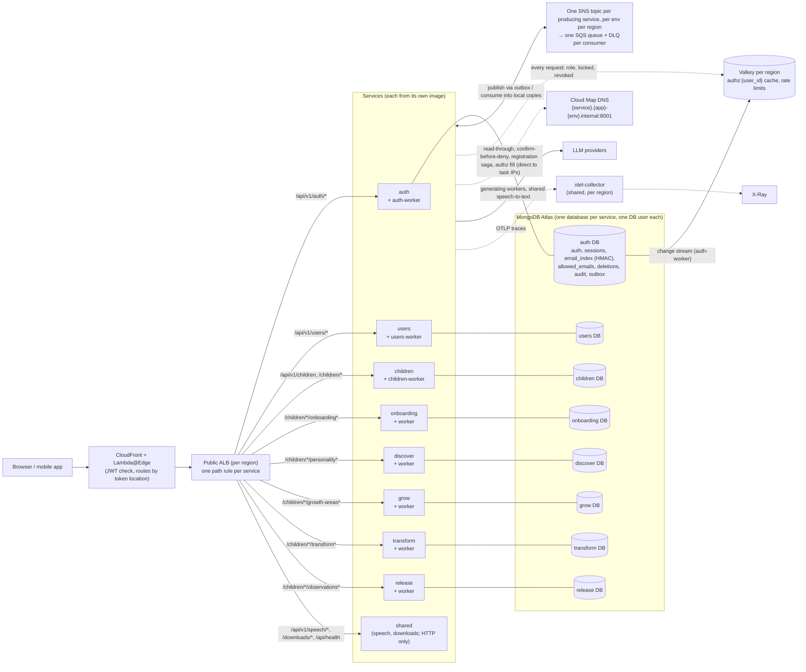
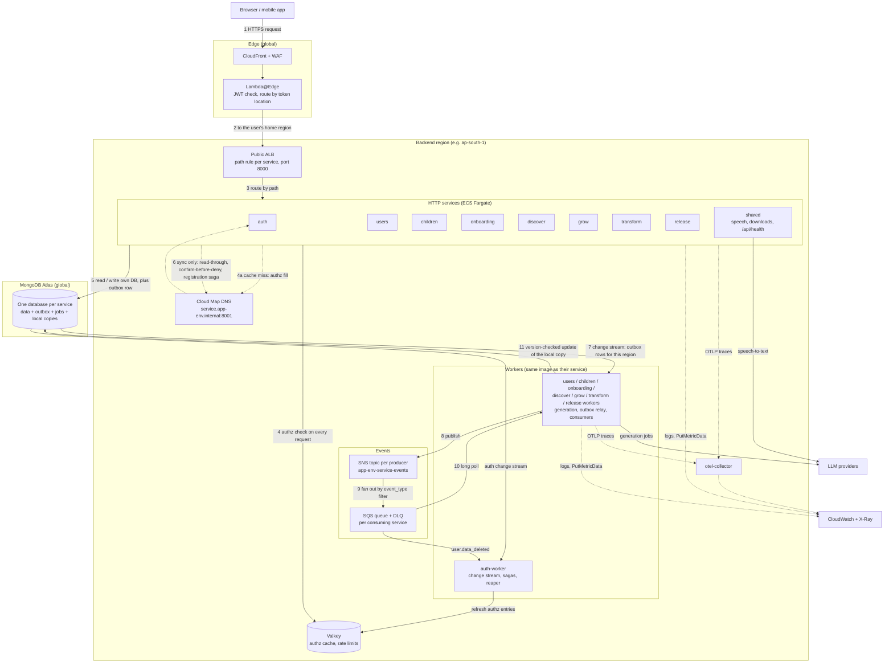
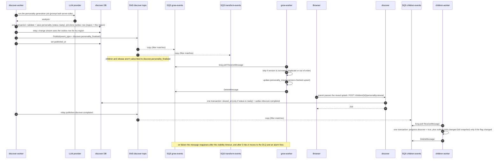
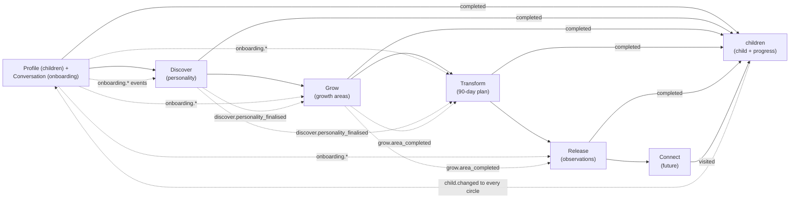
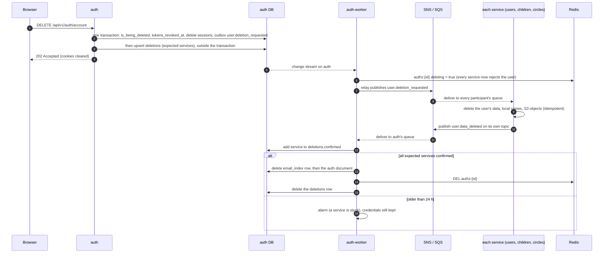

# Service split: auth, users and the journey circles

**Status:** proposal, 2026-10-22. Decisions taken (section 17); nothing is implemented yet.
**Greenfield:** no environment holds real data yet, so there is **no data migration**. Every database starts empty, and the services are built directly in their final shape (section 16).
**Scope:** split the single backend into services that each own their code and their database. That covers authentication, the user profile, the child, each journey circle and a stateless shared service. Cross-service data moves by **events into local copies**. Everything is ready for an Atlas Global Cluster later.

Related: [jwt-keys.md](jwt-keys.md), [infra-operations.md](infra-operations.md#adding-a-backend-service), [getting-started.md](getting-started.md), [production-readiness-review.md](production-readiness-review.md) (DB-01 database plan, DB-02 connection budget, EDGE-01 global login).

---

## 1. Starting point: the current code

The code below exists, but nothing it has written needs to be kept. This section is only what the new design replaces.

| Area | Today |
|---|---|
| Code | One FastAPI app. `APP_COMPONENT` (`auth` / `admin` / `api` / `worker`, plus `all` for local runs) picks which routers a task mounts, but all components share every module and **one database**. |
| User data | One `users` document holds both credentials and profile: `email`, `password_hash`, `full_name`, `role`, `country_code`, `location`, `preferences {tts_enabled, dark_mode, last_visited_path}`, `is_locked`, `tokens_revoked_at`, `is_being_deleted`, `created_at`, `updated_at`. |
| Child data | One `children` document mixes the child (name, age, gender, school, avatar) with **onboarding** answers and traits, the **discover** AI personality (`personality`, `pending_personality_vm`), the journey progress flags and the jobs lock (`active_jobs`). Six flags are stored; `grow_completed` is derived live from `growth_areas` (`services/journey_progress.py`). `PATCH /api/v1/children/{id}` refuses the flags, but they're still **client-reported**: `POST /children/{id}/progress/{flag}` sets them one-way after a precondition check, and `conversational_onboarding_completed` is set when the client PATCHes `onboarding_completed = true`. |
| Circle data | `growth_areas` (grow), `ninety_day_plans` (transform: main page, tracking, 3-month plan in one document), `observations` (release), `jobs` (all AI generation). |
| AI prompts | **Built in the browser** (`ninetyDayPlanPrompt.ts`, `growthQuestionsPrompt.ts`, `lifePathwayPrompt.ts`, …) and sent to `/llm/invoke` or `/jobs`. A signed-in user can send any prompt, at your cost. |
| Ids | `_id` is a **UUIDv4 string** (`str(uuid.uuid4())`). Every other collection stores it as `user_id`. |
| Email uniqueness and login | `email_index` (unsharded): `_id` = **plaintext email**, `user_id`, `location`. Login is a point read there, then `users.find_one({_id, location})`. |
| Sessions | `sessions`: `_id` = refresh-token `jti`, `user_id`, `location`, `expires_at`, swept by a background task. |
| Per-request check | `deps.get_current_user` reads `users` **on every request** (exists, `is_locked`, `tokens_revoked_at` vs `iat`, `role`). |
| Admin | A separate ECS service under `/api/v1/admin/*`. An admin is a `users` document with `role: "admin"`, promoted by hand in mongosh ([getting-started.md](getting-started.md)). |
| Account deletion | `DELETE /api/v1/user/me` deletes from seven collections directly. It doesn't delete the user's `jobs` or their S3 uploads. |
| `last_visited_path` | Written on every navigation by both frontends, **never read back**. |
| Secrets | One `backend-secrets` JSON and **one shared ECS execution role**, which can read every key. |
| Image and deploys | **One `backend` image** in one ECR repository per environment and region (`ecr_repository_url` in SSM). The deploy workflow builds it once and rolls it out to every selected service. |
| Health routes | `/health` (the container and target-group check) and `/api/health` (build metadata). `/api/health` sits outside `/api/v1`, reaches the backend through the ALB's catch-all rule, and is in the edge's `PURE_BYPASS_PATHS`. |
| Redis access | One shared AUTH token (`REDIS_AUTH_TOKEN`) for every task. If Redis is unreachable, the app falls back to per-task in-memory rate limits. |
| Email in logs | `sha256(email)[:16]`: unkeyed, so it can be matched against a list of candidate emails. |

### How the circles depend on each other

The seven circles are separate screens, but their AI generation reads earlier circles' data, and each unlocks only after the previous one:

| Circle | Its generation reads | Today's code |
|---|---|---|
| Discover (personality) | Onboarding answers and traits | `PersonalityJourney.tsx` |
| Grow (questions, life pathway, recommendations) | Personality traits, onboarding `strengths` / `hobbies`, growth answers | `growthQuestionsPrompt.ts`, `lifePathwayPrompt.ts`, `GrowthAreas.tsx` |
| Transform (90-day plan, tracker) | Onboarding/discover `strengths`, growth data | `ninetyDayPlanPrompt.ts` |
| Release (observations) | Onboarding answers, growth answers | `observationsData.ts` |
| All | The progress chain: profile → conversation → discover → grow → transform → release → connect | `children.py` (`mark_journey_progress`) |

These dependencies are why cross-service data moves by events into **local copies** (section 7), not by calls between services at request time.

---

## 2. Target shape

| Service | Owns | Runtimes (ECS services) |
|---|---|---|
| **auth** | Credentials, roles, sessions, email lookup, allow-list | `auth` (HTTP), `auth-worker` (authz change stream, sagas, outbox relay, reaper) |
| **users** | User profile: names, address, preferences | `users`, `users-worker` (outbox relay, deletion events) |
| **children** | The child (name, age, gender, school, avatar) and **journey progress** | `children`, `children-worker` (events) |
| **onboarding** | Conversational onboarding: the seven answers (traits) and the conversation's progress. The profile step's data (name, age, gender, school, avatar) is the child itself, so children owns it. | `onboarding`, `onboarding-worker` (outbox relay, events; **no AI generation**) |
| **discover** | AI personality | `discover`, `discover-worker` |
| **grow** | Growth areas: questions, answers, recommendations, child activity | `grow`, `grow-worker` |
| **transform** | The Transform circle's page: the Life Pathway (milestones per completed growth area) and the 90-day plan (main page, tracking, 3-month plan, event, photos) | `transform`, `transform-worker` |
| **release** | Observations | `release`, `release-worker` |
| **connect** | Connect circle (future). Its page has no data of its own yet, so until it does, children records the visit (13.4) and no connect service, database or queue exists. | `connect`, `connect-worker` (when built) |
| **shared** | Stateless shared capabilities: speech-to-text (voice input is used by several circles) and app downloads. **No database.** Named `platform` in earlier drafts; renamed because a `platform` package shadows Python's standard library. | `shared` |

The `-worker` runtimes come from the same image as their service. They run AI generation, the outbox relay and event consumers, so slow LLM work never competes with page requests. Every service that owns data has one, because it must at least relay its own events and handle `user.deletion_requested`. Platform, which owns no data, doesn't.



Labelled arrows from the public ALB are request routes (section 13.1). Each service box includes its worker, which runs from the same image. Plain lines to the databases show that each service uses only its own. The two-way arrow is events (section 7). Dotted arrows are the per-request authz check (9.3), the internal calls (13.2) and traces (15.5).

### Components and flow (one region)

The same system as a request and event flow, for one environment in one backend region. Other regions repeat everything inside the "Backend region" box; MongoDB Atlas and the edge are shared.



| Steps | Flow |
|---|---|
| 1–3 | A request goes through CloudFront and WAF, then Lambda@Edge checks the JWT and sends it to the user's home region. The ALB passes it to the service that owns the path (13.1). |
| 4, 4a | Every request checks `authz:{user_id}` in Valkey. On a miss, the service asks auth through Cloud Map, and auth refills the cache (9.3). |
| 5 | The service reads and writes only its own database. If others need to know about a change, it writes the change and an outbox row in one transaction (7.3). **The response goes back to the browser here.** |
| 6 | The few synchronous calls go directly to the callee's task IPs through Cloud Map, on port 8001: read-through on a missing copy, confirm-before-deny on a stale one, and the registration saga (7.5, 13.2). |
| 7–8 | The worker's relay sees this region's outbox rows and publishes each one to SNS. |
| 9–10 | SNS copies the message into every queue whose filter matches. Each consuming service's worker long-polls its own queue (7.2). |
| 11 | The consumer updates its local copy only if the event's version is newer, so a duplicate or late event changes nothing (7.4). Pages then read local data only. |
| Side flows | Generating workers and shared call the LLM providers (8). `auth-worker` keeps the authz cache current from the auth change stream and collects `user.data_deleted` confirmations (10.3). Traces go through the collector to X-Ray; logs and the 16 alarm metrics go straight to CloudWatch (15.5). |

### Ownership rules

- **A service never reads or writes another service's database.** For data it needs from elsewhere, it keeps a **local copy** fed by events. It calls another service's internal API only on a cache miss or a synchronous step of a saga.
- **One Atlas database user per service**, with access to its own database only.
- **One Secrets Manager secret and one ECS execution role per service** (section 15.1). Only auth can read the JWT private key and the HMAC pepper. Only generating workers and shared (speech-to-text) get LLM provider keys.
- **Services import only `common`**, never each other. CI enforces this with `import-linter`.
- **`common` is the protocol layer, not shared business logic.** Services stay isolated in data, runtime and access; `common` is a library built into each image, never something they share while running. It holds only code that **must behave identically in every service**, where copies would drift into security holes or broken events:
  - token and authz checks, and the permission table;
  - the event envelope, outbox, versions, tombstones and topic check;
  - the internal-call client and service tokens;
  - telemetry, logging and metrics conventions.

  Code used by one service lives in that service, even if another might want it one day. Code used by a few (uploads; generation) is an **optional extra** that only those services install.
- **Rules for `common`:**
  - **Versioned:** each service pins a `common` version, so a change to `common` doesn't force all 17 runtimes to redeploy at once.
  - **Backward-compatible changes only,** like event schemas (7.8). A breaking change is a new function next to the old one, until every service has moved.
  - **No circle rules:** anything about one circle belongs in that circle.
  - **One owner and full test coverage:** a bug there affects every service, so every change is reviewed by its owner.

---

## 3. User and child ids — **decided: UUIDv4 strings**

`sub` in the token, `_id` in `auth` and `users`, and `user_id` everywhere else are the **same UUIDv4 string**, created by auth at registration. Children get UUIDv4 `child_id`s from the children service.

Why not `ObjectId`:
- **Hot spot:** with the `{location, _id}` shard key, an increasing `ObjectId` puts every new document in a zone into that zone's last chunk. Random UUIDs spread the inserts.
- **Less change:** the current ids, code and tests already use UUID strings.
- **No timestamp leak:** an `ObjectId`'s first 4 bytes are its creation time.

---

## 4. Conventions for every database

- **Shard-key-ready:** every per-user or per-child collection has `location` and a unique `{location: 1, _id: 1}` index, ready for Atlas Global Writes (section 14).
- **Validators:** each collection gets a `$jsonSchema` validator, so a buggy writer can't store a malformed document.
- **Timestamps:** MongoDB doesn't generate `created_at` / `updated_at`. The owning service sets them on insert and on every write.
- **`schema_version`** (int) on every document. Code can then handle old and new shapes side by side when a schema changes.
- **Per-child documents carry `user_id`, `child_id` and `location`.** A query filtered by all three returns nothing for someone else's child, so ownership checks cost no extra read (section 12.3).
- **Every service that publishes events** has an `outbox` collection (section 7.3), and every generating service a `jobs` collection (section 8). An `inbox` exists only where a consumer has a side effect that can't safely run twice (7.3).
- **Every event handler is safe to run twice** (7.4). That's what makes at-least-once delivery harmless without an inbox.

### 4.1 Shared collection shapes

These collections appear in several databases with the same shape. `common` owns their models, validators and indexes.

**`outbox`** (every service that publishes, 7.3):

| Field | Type | Required | Notes |
|---|---|---|---|
| `_id` | string (UUIDv4) | ✅ | The event id |
| `event_type` | string | ✅ | e.g. `child.changed`; the SNS filter attribute |
| `schema` | string | ✅ | e.g. `child.changed.v1` (7.8) |
| `aggregate_id` | string | ✅ | The record the event is about (child id, user id, …) |
| `location` | string | ✅ | Same as the record's, so the row is sharded with it and the "change + outbox row" transaction stays in one zone (7.3, section 14) |
| `version` | int | ✅ | The record's version after this write (7.4) |
| `payload` | object | ✅ | Only what consumers need (7.6) |
| `region` | string | ✅ | Region of the task that wrote it; each relay publishes only its own (7.3) |
| `traceparent` | string | — | Trace context, sent as an SNS message attribute (15.5) |
| `created_at` | date | ✅ | |
| `published_at` | date \| null | — | Set by the relay; TTL deletes the row 7 days later |

**`inbox`** (opt-in: only for a consumer whose handler can't safely run twice, 7.3). No service needs one yet:

| Field | Type | Required | Notes |
|---|---|---|---|
| `_id` | string (UUIDv4) | ✅ | The event id; a duplicate is skipped |
| `event_type` | string | ✅ | |
| `processed_at` | date | ✅ | TTL 15 days |

**`child_access`** (every circle; one per child, fed by `child.changed` and `child.deleted`, 7.7):

| Field | Type | Required | Notes |
|---|---|---|---|
| `_id` | string (UUIDv4) | ✅ | The child id |
| `user_id`, `location` | string | ✅ | Ownership check (12.3) |
| `name`, `age`, `gender` | | — | For page headings and generation prompts |
| `progress` | object | ✅ | Same shape as children's `progress`; unlock checks (12.4) |
| `confirmed` | object | — | `{<circle>: true}` for unlocks confirmed with the circle that owns them (confirm-before-deny, 7.5). Kept apart from `progress` and **never touches `version`**, which is children's counter. |
| `is_deleted` | bool | ✅ | |
| `version` | int | ✅ | Children's version; older events are ignored (7.4) |
| `updated_at` | date | ✅ | |

**`*_inputs`** (local copies of other circles' data, 7.7). Each is keyed by the child (`growth_inputs` by `{child_id}:{area_id}`), carries `user_id`, `location`, the owner's `version` and `updated_at`, and holds only these fields:

| Collection | `_id` | Fields | From |
|---|---|---|---|
| `onboarding_inputs` | child id | The seven answers: `strengths`, `hobbies`, `thinking_pattern`, `communication_style`, `energy_level`, `social_behaviour`, `emotional_behaviour` | `onboarding.conversation_completed`, `onboarding.answers_updated` |
| `personality_inputs` | child id | `traits` (summary), `strengths` | `discover.personality_finalised` |
| `growth_inputs` | `{child_id}:{area_id}` (one per area) | `child_id`, `area_id`, `area_name`, `answers`, `child_activity_results`, `recommendations`, `ai_three_month_recommendations` (what the Life Pathway and observation prompts need; the Life Pathway prefers the AI recommendations, as today) | `grow.area_completed`, `grow.area_updated` |

**`tombstones`** (every service that holds per-child or per-user data or copies; 7.4):

| Field | Type | Required | Notes |
|---|---|---|---|
| `_id` | string | ✅ | `child:<child_id>` or `user:<user_id>` |
| `location` | string | ✅ | |
| `version` | int | ✅ | The final version from `child.deleted`; for a user, the `authz_version` that `user.deletion_requested` carries (auth's record has no other counter) |
| `deleted_at` | date | ✅ | TTL **30 days**, longer than SQS's 14-day retention plus the DLQ redrive window |

Written in the same transaction as the deletion. Before any upsert of a copy, a read-through write, or storing a generation job's result, the service checks for a tombstone of that child or user, and drops the write if there is one.

**`jobs`** (every generating service: discover, grow, transform, release; section 8):

| Field | Type | Required | Notes |
|---|---|---|---|
| `_id` | string (UUIDv4) | ✅ | The job id the page polls |
| `user_id`, `child_id`, `location` | string | ✅ | |
| `type` | enum | ✅ | The service's own job types only (below). The API calls it `kind`, with a short name (`plan` for `generate_ninety_day_plan`, …). |
| `target` | object | — | Which of the service's own documents receives the result, e.g. `{area_id}` for grow |
| `status` | enum `pending` / `processing` / `completed` / `failed` | ✅ | Today's `result_ready` disappears: the server validates and stores the result itself |
| `input_version` | int | ✅ | Version of the local inputs the prompt was built from |
| `llm_attempt`, `max_llm_attempts` | int | ✅ | Retries with backoff, as today |
| `retry_after` | date | — | |
| `claimed_at` | date | — | Set when a worker takes the job |
| `error` | string | — | Short reason; never the prompt or user data |
| `created_at`, `updated_at` | date | ✅ | |
| `completed_at` | date | — | Set when the job ends as `completed` **or** `failed`; the TTL index deletes it 7 days later (section 14) |

**Region scope, as today:** a region's workers claim only jobs whose `location` is in `locations_for_region(region)`, and the pending-job count is scoped the same way (today's `worker.py` does both). Without it, every region would claim, and count, every region's jobs from the global database.

Gone from today's jobs: the client-supplied `payload` (the prompt), `write_back` and the cross-collection allow-list. The server builds the prompt from its own data, and the job can write only to its own service's documents.

| Service | Job types (today's names) |
|---|---|
| discover | `generate_personality_analysis` |
| grow | `generate_growth_parent_questions`, `generate_growth_child_rounds`, `generate_recommendations` |
| transform | `generate_life_pathway`, `generate_ninety_day_plan`, `generate_event_tracker` |
| release | `generate_observations` |

`generate_activity` is dropped: only `ChildActivityGame.tsx` uses it, and that component is deleted (section 8).

---

## 5. Auth and users

### 5.1 `auth.auth` — credentials, role and account state

| Field | Type | Required | Notes |
|---|---|---|---|
| `_id` | string (UUIDv4) | ✅ | The user id; `sub` in every token |
| `email` | string | ✅ | Normalised (6.3). Plaintext, but only here, in the user's own zone. **The only place a user's email is stored.** |
| `password_hash` | string | ✅ | bcrypt, cost 12, as today. Google sign-ups get a random unusable password hashed the same way. |
| `role` | enum `parent` / `admin` | ✅ | **The single source of truth for roles** (section 11) |
| `country_code` | string (ISO 3166-1 alpha-2) | ✅ | Validated against `COUNTRY_TO_REGION` / `BLOCKED_COUNTRIES` |
| `location` | string | ✅ | From `resolve_region(country_code)`. **Immutable**: moving a user means moving their documents, not updating a field. |
| `auth_provider` | enum `password` / `google` | ✅ | |
| `tokens_revoked_at` | date \| null | — | Tokens issued at or before it are rejected; compared in milliseconds (9.3) |
| `authz_version` | int | ✅ | Incremented on every change to `role`, `is_locked`, `is_being_deleted` or `tokens_revoked_at`; orders writes to the authz cache (9.3) |
| `is_locked` | bool | — | Admin lock |
| `is_being_deleted` | bool | — | Set at the start of deletion (section 10) |
| `created_at`, `updated_at`, `schema_version` | | ✅ | |

### 5.2 Other `auth` collections

Auth also has an `outbox` (4.1): it publishes `user.deletion_requested`.

**`sessions`** (one per refresh token):

| Field | Type | Required | Notes |
|---|---|---|---|
| `_id` | string (UUIDv4) | ✅ | The refresh token's `jti` |
| `user_id`, `location` | string | ✅ | |
| `family_id` | string (UUIDv4) | ✅ | Rotation chain; reuse of a rotated token revokes the whole family (9.1) |
| `expires_at` | date | ✅ | TTL index deletes the row when it passes (section 14), replacing today's cleanup task |
| `rotated_at`, `replaced_by` | date, string | — | Set when the token is refreshed, instead of deleting the row, so a reuse can be recognised (9.1) |
| `created_at` | date | ✅ | |

**`email_index`** (one per email, unsharded):

| Field | Type | Required | Notes |
|---|---|---|---|
| `_id` | string (64 hex) | ✅ | `HMAC-SHA256(pepper, normalised email)` (section 6) |
| `key_version` | int | ✅ | Pepper version used (6.5) |
| `user_id`, `location` | string | ✅ | Where the account lives |
| `status` | enum `reserved` / `active` | ✅ | Login needs `active` (10.1) |
| `reserved_at` | date | ✅ | A `reserved` row older than 15 min is reclaimed by the reaper |

**`allowed_emails`** (the allow-list, unsharded):

| Field | Type | Required | Notes |
|---|---|---|---|
| `_id` | string (64 hex) | ✅ | HMAC key, as in `email_index` |
| `key_version` | int | ✅ | |
| `email_hint` | string | ✅ | Masked, e.g. `j***@example.com`, so admins can tell entries apart |
| `added_by` | string (UUIDv4) | ✅ | Admin's user id |
| `created_at` | date | ✅ | |

**`deletions`** (one per account deletion in progress, unsharded):

| Field | Type | Required | Notes |
|---|---|---|---|
| `_id` | string (UUIDv4) | ✅ | The user id |
| `location` | string | ✅ | |
| `requested_at` | date | ✅ | The alert fires after 24 h (10.3) |
| `expected` | string[] | ✅ | From `common.deletion.PARTICIPANTS` |
| `confirmed` | string[] | ✅ | Services that sent `user.data_deleted` |

**`audit`** (privileged actions and denials handled by auth, section 11.3):

| Field | Type | Required | Notes |
|---|---|---|---|
| `_id` | string (UUIDv4) | ✅ | |
| `actor_id`, `actor_role` | string | ✅ | Who acted |
| `location` | string | ✅ | The actor's location; the shard key's prefix. Audit rows are written **after** the zone transaction they describe, never inside it |
| `permission` | string | ✅ | e.g. `accounts:lock` |
| `subject_id` | string | — | Whose account |
| `privileged` | bool | ✅ | Allowed only because of the role |
| `outcome`, `status_code` | string, int | ✅ | `allowed` / `denied` |
| `request_id`, `source_ip`, `route` | string | ✅ | |
| `changed_fields` | string[] | — | Field **names** only, never values |
| `created_at` | date | ✅ | TTL at the agreed audit retention (section 14) |

### 5.3 `users.users` — profile

Users also has `outbox` and `tombstones` (4.1): it publishes `user.data_deleted`.

| Field | Type | Required | Notes |
|---|---|---|---|
| `_id` | string (UUIDv4) | ✅ | Same as `auth._id` |
| `version` | int | ✅ | Incremented on every write (7.4) |
| `first_name` | string | ✅ | |
| `middle_name`, `last_name` | string | — | |
| `location` | string | ✅ | Same as in `auth`; immutable |
| `preferences.tts_enabled` | bool | ✅ | Default `true` |
| `address_line_one` / `_two` / `_three` | string | — | Personal data: export, deletion, never logged |
| `created_at`, `updated_at`, `schema_version` | | ✅ | |

**Deliberately absent:**
- **`email`:** auth holds it. A service that needs it calls auth's internal API.
- **`full_name`:** it's gone from storage, APIs and tokens. The apps join the non-empty name parts with single spaces where they show a name; no service needs a full name.
- **`dark_mode`:** stored today, but neither app reads or writes it: the web theme is locked to dark on purpose (`frontend/src/lib/theme.tsx`). Add it back when theming is turned on.
- **`last_visited_path`:** it's written but never read today. Remove it, along with its writes in `frontend/src/lib/AuthContext.tsx`, `frontend/src/hooks/useStartOver.ts` and the same two files in `frontend-app/`.

---

## 6. Email lookup with HMAC — **decided**

### 6.1 What it is

A collection that isn't sharded sits in **one** region of the Global Cluster. Storing plaintext emails there would put every user's email in that region, whatever zone the user is in. Instead, `email_index` and `allowed_emails` are keyed by a **keyed hash**:

```text
normalised = lowercase(trim(email))                 # "  Jane.Doe@Example.com " → "jane.doe@example.com"
key        = HMAC-SHA256(pepper, normalised)        # 64 hex chars
email_index: { _id: key, key_version: 1, user_id, location, status }
```

- The same email and the same pepper always give the same key, so lookup and uniqueness work exactly as before.
- Without the pepper, the key reveals nothing and can't be recomputed.

### 6.2 Why HMAC and not a plain hash

| Key | Can someone with a copy of `email_index` find out the emails? |
|---|---|
| Plaintext email | Yes, they're right there. |
| `sha256(email)`, unkeyed | **Yes, easily.** Emails are guessable: hash a list of candidates (marketing lists, breach dumps, `firstname.lastname@company` patterns) and compare, at billions of hashes per second. |
| `HMAC-SHA256(pepper, email)` | **No**, not without the pepper. |
| bcrypt/argon2 of the email | Also safe, but deliberately slow (about 250 ms per check), and a per-row salt would break lookup |

### 6.3 How it's used

| Operation | Steps |
|---|---|
| Register | Normalise → HMAC → insert `email_index {status: reserved}`. A duplicate key means the email is taken. |
| Login | Normalise → HMAC → `email_index` → `{user_id, location}` → targeted read of `auth.auth` |
| Allow-list check | Normalise → HMAC → `allowed_emails` point read |
| Find an account by email (admin) | Normalise → HMAC → `email_index` → `auth.auth` |
| Logs | Log `key[:16]` instead of today's unkeyed `sha256(email)[:16]` |

**Normalisation must be identical everywhere:** one function, `auth.emails.normalise()` (only auth handles emails, so it lives in auth), which trims and lower-cases and nothing else. No Gmail dot or `+tag` stripping, because that changes which mailbox the address means. Any difference between code paths silently creates duplicate accounts.

### 6.4 The pepper

- **What:** 32 random bytes (`openssl rand -hex 32`).
- **Where:** a Secrets Manager secret that **only auth** can read, one per environment, and not in the database, tfvars or GitHub variables.
- **The same in every region of an environment**, because lookups are global.
- **Losing it** makes every key unmatchable. Back it up with the other environment secrets.

### 6.5 Rotating the pepper

1. Add pepper **v2** next to **v1**. Auth looks up v2 first, then falls back to v1. **Registration and allow-list additions check both versions** before inserting, so an email with a v1 row can't get a second account under v2.
2. **Re-key:** a one-off job reads each `auth.auth` document (which has the plaintext email), inserts a v2 `email_index` row and deletes the v1 row.
3. When no v1 rows remain, remove v1.

`allowed_emails` holds no plaintext, so it can't be re-keyed. Keep v1 lookups until outstanding entries are used, or have admins re-add them.

### 6.6 What it doesn't protect

- **`auth.auth.email`:** plaintext, but in the user's own zone, and needed to show the address and contact the user.
- **A compromised auth task:** it can compute keys. Least privilege limits this to one service.

---

## 7. Events and local copies

### 7.1 Why

Each circle needs a few fields from earlier circles, and every service needs to know which children belong to whom. Calling the owner on every request would couple services at runtime: a grow outage would break transform's page. Instead:
- **Owners publish an event** whenever data that others rely on changes.
- **Consumers keep a local copy** of only the fields they need, in their own database.
- **Pages and generation read local data only.**

### 7.2 Transport: SNS + SQS per region

| Piece | Choice |
|---|---|
| Bus | **One SNS topic per producing service**, per environment per region (`{app}-{env}-{service}-events`): 8 topics. A service may publish only to its own topic, which IAM can enforce, unlike event types: SNS has no IAM condition on message attributes. |
| Who may publish what | Each event type has one producer (7.6), **except `user.data_deleted`**, which every service with user data publishes. For that one, `common.events` accepts any producer topic, and auth takes the confirming `service` **from the `TopicArn`, never from the payload**, so grow can't confirm deletion on behalf of users. `common.events` rejects an event whose `event_type` doesn't belong to the topic it came from (the message's `TopicArn`), so a compromised service can't, for example, publish `user.deletion_requested` or `discover.completed`. For the check to hold: every subscription keeps **raw message delivery off** (the SNS envelope, with `TopicArn`, is delivered), and each queue's **queue policy** allows `sqs:SendMessage` only from its subscribed topic ARNs (`aws:SourceArn`), so nothing can put a forged envelope straight into a queue. |
| Per consumer | One **SQS queue per consuming service**, subscribed with a **filter policy** on `event_type`, plus a dead-letter queue (DLQ) after 5 failed attempts |
| Ordering | Not guaranteed (standard SNS/SQS). Consumers handle it with versions (7.4). |
| Region | Events are published and consumed in the region that handled the write. MongoDB is global, so the local copies a consumer writes are global too. Only Redis is regional, and it's fed by the change stream (9.3). |
| Why not EventBridge or Kafka (MSK) | SNS+SQS is the simplest managed fan-out with per-consumer retries and DLQs. EventBridge adds routing features this design doesn't need. **MSK** charges for brokers by the hour: about $66 a month for the smallest 2-broker cluster, about $460 for 3 × `m5.large`, per region. So it's far more expensive until roughly 10M–100M monthly active users. It also has no built-in DLQ or filtering; its advantages are replay and per-partition ordering. Revisit it above about 1,000 events per second. `common.events` keeps the transport swappable. |

### 7.3 Reliable publishing: the outbox

A service must never save a change and then fail to publish its event, or the reverse.
1. **One transaction, one database:** the change and an `outbox` document `{_id: event_id, event_type, schema, payload, aggregate_id, location, version, region, traceparent, created_at, published_at: null}` (fields in 4.1) are written together. `region` is the AWS region of the task that handled the request.
2. **The relay** in the service's worker watches `outbox` (change stream, with a polling fallback), publishes to SNS and sets `published_at`. On a crash it publishes again, so delivery is **at least once**.
   - **Each region's relay handles only rows with its own `region`** (in the change-stream filter and the polling query). MongoDB is global, so without that filter every region's relay would see every region's outbox writes and publish each event once per region.
   - If a region is down, its unpublished rows wait. An operator can let another region's relay take them over by changing their `region`.
3. **`outbox` has a TTL index** on `published_at`: rows are deleted 7 days after publishing.

Consumers make duplicates harmless. The outbox and SQS both deliver **at least once**, so any event can arrive twice.
- **The rule: every handler is safe to run twice** (7.4). Then a duplicate changes nothing, and no extra bookkeeping is needed.
- **`inbox`, opt-in:** only for a handler with a side effect that can't be repeated safely, such as sending an email or notification, or incrementing a counter.
  - It's `{_id: event_id, event_type, processed_at}`, written in the same transaction as the handler's change. An event already there is acknowledged and skipped.
  - TTL of 15 days, longer than SQS's maximum message retention (14 days), so a redelivered message is always recognised.
  - Turned on per handler in `common.events`, e.g. `@consumer("user.role_changed", dedupe=True)`. That creates the collection in that service only.
  - **No service needs it yet.** Every handler in the event catalogue (7.6) is a version-checked upsert, a one-way flag, a set operation or a delete.

### 7.4 Versions and ordering

- Every event carries the owner's **`version`** for that record: a counter incremented on every write.
- A consumer applies an event only if its `version` is higher than the one stored on its local copy. Older or duplicate events are ignored.
- **Tombstones:** a deletion event carries the final version, and the consumer keeps a **tombstone** row after deleting its copy or data (4.1). A late update, a read-through or a finishing generation job for that child or user finds the tombstone and is dropped, so deleted data can't come back.

**Every handler is safe to run twice.** It must be one of these kinds, and a test replays each event twice to check it:

| Kind | Example | Why a duplicate is harmless |
|---|---|---|
| Version-checked upsert | Update `child_access` or `personality_inputs` from `child.changed` / `discover.personality_finalised` | Applied only if the event's `version` is newer than the stored one |
| One-way flag | Children sets `progress.discover = true` | Setting `true` again changes nothing |
| Set operation | Auth adds the service to `deletions.confirmed` (`$addToSet`) | A set can't hold the same value twice |
| Delete | A circle deletes a child's data on `child.deleted` | Deleting again finds nothing to delete |

- **Follow-up events only on a real change:** a handler publishes a follow-up event only if its update actually modified the document. For example, children publishes `child.changed` only when a flag goes from `false` to `true`, so a duplicate `discover.completed` doesn't create a second event.
- **One snapshot event per write:** when one write changes several things, the owner publishes **one** event with the whole current state, not one partial event per change. Two partial events would carry the same `version`, and because delivery isn't ordered, a consumer could apply one and drop the other as "not newer". Children, for example, publishes a single `child.changed` with every `child_access` field, including progress.
- **Anything else** (an email, a notification, a counter) uses the opt-in `inbox` (7.3).

**One event, end to end** (discover finishes a personality; grow and transform need it, and children later marks Discover done when the parent passes the reveal):



### 7.5 Missing or stale copies: read-through

The frontend never waits for events: an API call returns as soon as the service has saved its own data and outbox row, and events reach other services afterwards, usually within a second. A local copy can therefore be **missing** or **behind** for a moment, for example right after a child is created or a circle is completed.

**Missing copy:** for example, the onboarding page opens before the first `child.changed` has arrived.
1. The service calls the owner's internal API once (`GET /internal/children/{id}`, …).
2. It stores the result with the owner's `version`.
3. It continues. Later events with higher versions overwrite it.

**Stale copy: confirm before you deny.** A local copy may be used to **allow** something, but never on its own to **refuse** it, because a "no" may only mean the copy is behind.
1. If a check against a local copy would refuse the request (circle locked, item not found, not yet completed), the service asks the **owner of that fact** once, over Cloud Map (13.2).
2. If the owner says yes, the service records it and continues as if the copy had been current. **It doesn't overwrite the copy with the owner's version**, which counts something else: for an unlock it sets `child_access.confirmed.<circle> = true`, and for a missing copy it stores what read-through returned (step above). A later event with a higher version still applies normally.
3. Only a "no" from the owner returns the refusal (403, 404 or 409).
4. If the owner is unreachable, the service returns **503** with `Retry-After`, not the refusal, so a short outage doesn't show the parent a wrong "locked" screen. The frontend retries once, then shows a "try again" message.

This costs one internal call only in the rare case where the copy is behind; normal page loads still read local data only.

**Out of scope for this rule:**
- **Revocations** (lock, logout everywhere, deletion, role change) don't depend on local copies. They're enforced through the authz cache on every request (9.3).
- **Stale "allow" answers** are accepted. For example, a child deleted a second ago may still pass a `child_access` check for that second. Its data is being deleted anyway, and only its own parent could make the request.
- **Display-only staleness**, such as Home's progress rings or another circle's summary a second behind, is accepted. The next load shows the update.

### 7.6 Event catalogue

| Event | Producer | Payload (beyond ids, `location`, `version`) | Consumers |
|---|---|---|---|
| `user.deletion_requested` | auth | — | every service holding user data |
| `user.data_deleted` | each service | — (the confirming service is the producer topic it came from, 7.2) | auth (deletion saga) |
| `user.role_changed` | auth | `role` | **Reserved, not published yet:** no service consumes it. Role changes are already audited in auth's `audit` collection and alarmed (11.3). Publish it when a consumer exists, such as a notification sender. |
| `user.profile_updated` | users | `first_name`, `middle_name`, `last_name` | **Reserved, not published yet:** its only planned consumer is connect (display names), which doesn't exist. Publish it when connect is built. |
| `child.changed` | children | **The full `child_access` snapshot:** `user_id`, `name`, `age`, `gender`, `is_deleted` (soft delete, 10.2) and all seven `progress` flags. One event per write, whatever changed (7.4). Replaces separate created / updated / progress events. | onboarding, discover, grow, transform, release (and connect once built): copies, unlock checks (12.4). Transform also clears Life Pathway milestones when `age` or `gender` differs from its copy. |
| `child.deleted` | children | `user_id` | every circle (delete that child's data; published by the purge, 30 days after the soft delete) |
| `onboarding.conversation_completed` | onboarding | `strengths`, `hobbies`, `thinking_pattern`, `communication_style`, `energy_level`, `social_behaviour`, `emotional_behaviour` (today's seven answers; add new ones as optional fields, 7.8) | discover (starts the personality), grow, transform, release; children (progress) |
| `onboarding.answers_updated` | onboarding | the same seven answers | grow, transform, release. Not discover: the personality isn't regenerated when answers change (12.1). |
| `discover.personality_finalised` | discover | `traits` (summary), `strengths` | grow, transform (copies) |
| `discover.completed` | discover | — | children (progress): the parent has passed the reveal splash |
| `grow.area_completed`, `grow.area_updated` | grow | `area_id`, `area_name`, `answers`, `child_activity_results`, `recommendations`, `ai_three_month_recommendations` (`area_updated` also when the AI recommendations of a completed area are generated) | transform (Life Pathway; an update clears that area's milestones), release |
| `grow.completed` | grow | — | children (progress) |
| `transform.completed` | transform | — | children (progress) |
| `release.completed` | release | — | children (progress) |
| `connect.visited` | connect | — | **Reserved, not published yet:** children records the Connect visit itself until a connect service exists (13.4). |

**An event is published only once a service consumes it:** an outbox write and a publish with no subscriber cost something and help nothing. Reserved events stay in the catalogue so their names and payloads are agreed in advance.

**Payloads carry only what consumers need.** Each payload field is someone's local copy, so fewer fields means less duplicated personal data.

### 7.7 Local copies, service by service

| Service | Local copies (collection) | From |
|---|---|---|
| every circle | `child_access {_id = child id, user_id, location, name, age, gender, is_deleted, progress}` (fields in 4.1) | `child.changed`, `child.deleted` |
| discover | `onboarding_inputs` | `onboarding.conversation_completed` |
| grow | `onboarding_inputs`, `personality_inputs` | `onboarding.*`, `discover.*` |
| transform | `onboarding_inputs`, `personality_inputs`, `growth_inputs` | `onboarding.*`, `discover.*`, `grow.*` |
| release | `onboarding_inputs`, `growth_inputs` | `onboarding.*`, `grow.*` |
| children | (none; it owns progress and consumes completion events) | |

Local copies:
- are **read-only** for the consumer;
- are **deleted** on `child.deleted` and `user.deletion_requested`, leaving a tombstone so a late event or read-through can't recreate them (7.4, 4.1);
- follow the same encryption and retention rules as the source.

**How the circles feed each other:**



Solid arrows between circles are the order a parent goes through them. Dotted arrows are events feeding each circle's local copies. Arrows into children are progress updates (12.4). Children's `child.*` events go to every circle; only one arrow is drawn to keep the diagram readable.

### 7.8 Contracts

- Event schemas live in `backend/common/events/schemas/` as versioned JSON Schema, e.g. `child.changed.v1.json`.
- A **contract test** in CI checks that every producer emits valid payloads, and that every consumer handles every schema it subscribes to.
- **Changes are additive only:** add optional fields. A breaking change is a new event version (`.v2`) published alongside the old one until every consumer moves.
- This matters because deploys roll services out **in parallel**, so producers and consumers run different versions for a while.

---

## 8. AI generation

**Each circle owns its generation:** job types, prompt building, LLM calls and storing results all happen in its own service, in its own database.

| Today | New |
|---|---|
| The browser builds prompts and posts them to `/llm/invoke` or `/jobs` | The browser asks for a result: `POST /api/v1/children/{id}/personality/generation`. The **server** builds the prompt from its own data plus its local copies. |
| One shared `jobs` collection with a write-back allow-list into other collections | A `jobs` collection **per generating service**. A job can write only to its own service's collections. |
| `active_jobs` lock on the child document | An `active` field on the circle's own document (one job per type per child) |

Shared code in `common.generation`:
- the job model and queue (stored in the calling service's database);
- the LLM provider client and timeouts;
- the **per-user LLM rate limit in Redis** (keyed by `user_id`), so the hourly limit applies across every circle, not per service;
- a prompt-template helper.

Results the client used to "finalise" (for example `pending_personality_vm` → `personality.view_model`) are now validated and promoted **by the server** when the job completes. That removes the client's ability to save arbitrary JSON into those fields.

**`/llm/invoke` is removed.** Nothing sends raw prompts to the backend.

**LLM keys** are injected only into the workers of services that generate (discover, grow, transform and release; onboarding only collects answers), plus shared, whose speech-to-text uses OpenAI (`OPENAI_API_KEY`), as `/audio/transcribe` does today.

**Removing `/llm/invoke` breaks no live page.** Its only synchronous callers are `RecommendationsPhase.tsx` and `ChildActivityGame.tsx`, and neither is rendered: nothing imports `RecommendationsPhase`, and `ChildActivityGame` is used only by it. Delete both components along with the endpoint.

---

## 9. Login, tokens and per-request authorization

### 9.1 Login and sessions

1. **Throttle by email key and IP, first:** normalise and HMAC the email; after 5 failures in 15 min for that key from one IP, reject further attempts from that IP for 15 min, before any lookup. Counting per key *and* IP means nobody can lock a user out from elsewhere. Counters live in Valkey, as well as today's per-IP limits.
2. Read `email_index`. If there's no `active` row, run a dummy bcrypt check (timing-safe) and return 401.
3. Read `auth.auth` with `{_id, location}`, a targeted single-zone read.
4. Verify the password (the dummy hash if the account is being deleted).
5. **Only with the right password**, refuse an account that's being deleted (401) or locked (403), so the lock status isn't revealed to someone without the password. Then issue tokens, create a `sessions` row with a new `family_id`, and warm the authz cache.

**Refresh-token rotation with reuse detection:**
- Each refresh issues a new refresh token in the same `family_id`, and marks the old session `rotated_at` / `replaced_by` instead of deleting it.
- If a rotated token is presented again **within 30 seconds**, it's a concurrent refresh (two tabs at once): issue another pair in the same family.
- **Later than that**, the token was stolen: delete every session in the family, and set `tokens_revoked_at`.
- **Log out everywhere:** `POST /api/v1/auth/logout-all` sets `tokens_revoked_at` and deletes all the user's sessions.

Login runs in the bootstrap region (edge PURE_BYPASS); step 2 may be one cross-region read.

### 9.2 Claims

| Claim | Access | Refresh | Notes |
|---|---|---|---|
| `iss`, `aud`, `iat`, `exp`, `type` | ✅ | ✅ | As today; access 30 min, refresh 24 h |
| `iat_ms` | ✅ | ✅ | **New:** the issue time in milliseconds, compared with `revoked_at_ms` (9.3). `iat` stays in seconds, as the JWT standard requires |
| `sub` | ✅ | ✅ | The user id |
| `location` | ✅ | ✅ | The edge routes on it; services use it for targeted queries |
| `role` | ✅ | — | **New:** today's access token has no `role`. For cheap coarse checks only; the cached role is authoritative (9.3) |
| `jti`, `family_id` | — | ✅ | |
| `email`, names | ❌ | ❌ | A JWT is signed, not encrypted: anyone holding the cookie can read it |

### 9.3 Per-request checks and the authz cache

A valid token isn't enough. Within its lifetime an admin can lock the account, the user can log out everywhere, deletion can start or the role can change. Every service therefore checks a **per-region Redis cache**:

```text
authz:{user_id} → {"ver":42,"role":"parent","locked":false,"deleting":false,"revoked_at_ms":1792500000123}
TTL 1 h
```

1. Verify the JWT.
2. `GET authz:{sub}`.
   - On a hit, use it.
   - On a miss, call auth's `GET /internal/authz/{user_id}`, which reads `auth.auth` and refills Redis.
3. Reject:
   - `deleting` → 401;
   - `locked` → 403;
   - `revoked_at_ms >= iat_ms` → 401. Both in **milliseconds**, so a token issued in the same second as a logout-all, lock or role change isn't rejected by mistake;
   - a missing permission for the cached role → 403 (section 11).
4. **Fail closed — decided:** if the entry is missing and auth is unreachable, return **503**.

**Keeping it current:**
- **Change stream:** an `auth-worker` in **every** region watches **all** of `auth.auth`, not only its own users, and updates that region's cache through the versioned write. It updates only keys the region already holds, so regions don't fill up with every user. That matters because entries can be written outside a user's home region: login runs in the bootstrap region, an admin's lock lands in the admin's region, and failover can serve a user anywhere. It stores a resume token, and needs a dedicated Atlas cluster (M10+).
- **Every authz-changing write bumps the version:** registration inserts `authz_version: 1`. Every change to role, lock, deletion or revocation (lock, unlock, role change, logout-all, refresh reuse, account deletion) is one `findOneAndUpdate` with `$inc: {authz_version: 1}`, and the cache is written with the returned value.
- **Versioned writes, so a slow fill can't undo a lock:**
  - `auth.auth` has an `authz_version` that increases on every change to role, lock, deletion or revocation. The entry carries it as `ver`.
  - Every write to `authz:*` (the fill, the change stream, auth's own updates) goes through one Lua script that accepts only a **strictly higher** `ver`, or an equal `ver` with identical content.
  - So a fill that read `locked: false` just before an admin locked the account can't overwrite the newer `locked: true`.
- **TTL 1 hour:** the change stream keeps entries current, so the TTL only limits how long a missed update could survive, for example after a Valkey failover that loses a write. One extra auth read per active user per hour is the cost.
- **Eviction:** the default `volatile-lru` can evict entries. That's safe, because a miss refills.
- **Redis RBAC users:** every service can read `authz:*`; only `auth` and `auth-worker` can write.
  - **Today** every task shares one AUTH token. ElastiCache RBAC replaces it: a user group on the replication group, one ElastiCache user per service, each with an access string limiting its key patterns and commands. For example `on ~authz:* +get` for a reader, and `~authz:*` write commands for auth.
  - A replication group uses either an AUTH token or a user group, not both. So `modules/redis` swaps `auth_token` for `user_group_ids`, plus a new `aws_elasticache_user` / `aws_elasticache_user_group` per service. The same RBAC users also control the rate-limit and LLM-limit keys (15.1).
  - **IAM authentication** for those users (Valkey 7+): each task gets a short-lived token from its task role, so there are no Redis passwords to store or rotate. Use passwords in Secrets Manager only if IAM auth turns out not to fit the client.

**When Redis is unreachable:**
- **The authz check still works, at a cost:**
  - Every request then misses and asks auth (`GET /internal/authz/{user_id}`), and auth reads `auth.auth`.
  - Each service keeps a **small in-process cache** of those answers for **30 seconds**, so one user's burst of requests costs one internal call, not one per request.
  - A lock, revocation or deletion therefore takes effect within 30 s while Redis is down, rather than at once.
- **Auth must carry that load:** it scales on CPU, and its `/internal/authz` endpoint is a single indexed read. The "Redis unreachable" alarm (an ElastiCache health or connection-error metric) tells operators the slower mode is on.
- **Fail closed still applies:** only if Redis and auth are both unavailable does a request get **503**.
- **Rate limits** fall back to per-task in-memory limits, as today. The cross-service hourly LLM limit becomes per task until Redis returns.
- **Login's per-key-and-IP throttle** (9.1) also falls back to per task, so a short Redis outage weakens it rather than blocking logins.

**Login, then a later request:**


---

## 10. Sagas

### 10.1 Registration

1. **Check:** the email's HMAC is in `allowed_emails`, the country isn't blocked, and the password policy is met. Resolve `location`.
2. **Reserve:** `email_index {_id: HMAC, user_id: <new uuid>, location, status: reserved, reserved_at}`. A duplicate on an `active` row returns 409. A stale `reserved` row (15 min) is reclaimed, after deleting whatever the old attempt left (its `auth.auth` and profile).
3. **Credentials:** insert `auth.auth` (`role: parent`, `auth_provider`).
4. **Profile:** call users' `PUT /internal/users/{user_id}` with names, `location` and address (an upsert, so retries are harmless). **No email.**
5. **Activate:** `email_index.status = active`.
6. **Sign in:** tokens, session, authz cache.

**Failure handling:**
- Steps 3–4 failing are undone in reverse order. If step 4 timed out, the profile may exist anyway, so the undo also calls users' idempotent `DELETE /internal/users/{user_id}`.
- The `auth-worker` reaper cleans up `reserved` rows older than 15 min.
- Login requires an `active` row, so a half-made user can't log in.

**Google sign-up** is the same, with `auth_provider = google`: `given_name` → `first_name` and `family_name` → `last_name`, falling back to the email's local part.

### 10.2 Child deletion

`DELETE /api/v1/children/{id}`:
1. **Soft delete:** the children service sets `is_deleted` and publishes `child.changed` (with `is_deleted: true`). Each circle marks its `child_access` copy deleted, so the child disappears everywhere at once, but its data is kept for **30 days**, as today's soft delete promises.
2. **Purge:** after 30 days, the `children-worker` purge job hard-deletes the child, its avatar and its own outbox rows about the child, and publishes `child.deleted`.
3. **Each circle then deletes** its data for that child, plus its S3 objects (plan photos) and its outbox rows about the child (`child.deleted` rows stay), drops the child from its `child_access` copy and writes a tombstone. Pending or running generation jobs for that child are marked `failed` (`error: "cancelled"`), and a job that finishes later finds the tombstone and stores nothing.

There's no restore endpoint; within the 30 days, support can restore a child by clearing `is_deleted`. Account deletion (10.3) skips the 30 days and deletes everything at once.

### 10.3 Account deletion

`DELETE /api/v1/auth/account`:
1. **Start (synchronous):**
   - Auth sets `is_being_deleted = true` and `tokens_revoked_at = now`.
   - It deletes sessions and clears cookies.
   - In one transaction, in the user's zone: the flags above, the session deletes, and the outbox event `user.deletion_requested`.
   - **Then, outside the transaction**, it upserts `deletions {_id: user_id, expected: [users, children, onboarding, discover, grow, transform, release], confirmed: []}` (plus `connect` once it exists). `deletions` is unsharded, so including it would make a cross-region distributed transaction (section 14). The upsert is idempotent, and the `auth-worker` creates the row too if a crash skipped it, when the first `user.data_deleted` arrives.
   - It returns **202**.
   - The authz cache flips to `deleting`, so every service rejects the user from now on.
2. **Each service deletes** everything it holds for that user, including local copies, S3 objects and its own outbox rows about the user or their children (published rows keep their payloads for 7 days; `user.data_deleted` rows stay), cancels the user's pending generation jobs, and writes a `user:` tombstone. It then publishes `user.data_deleted` on its own topic, which tells auth which service confirmed (7.2). Deleting twice is a no-op, so this is idempotent.
3. **`auth-worker`** records each confirmation in `deletions.confirmed`. When `confirmed ⊇ expected`, it deletes `email_index`, then `auth.auth`, then `authz:{id}`, then the `deletions` row.
4. **Alert** on any deletion older than 24 h, which points to a stuck service. **Credentials are always deleted last**, so a stuck deletion can't be logged into, and can still be resumed.



The `expected` list comes from one place, `common.deletion.PARTICIPANTS`. A test fails if a service with user data isn't on it.

**Admins:** auth refuses to delete, demote or lock the **last** active admin. A count-then-act check would let two admins demote each other at the same moment and leave none, so it uses a counter: one unsharded `auth.admin_count {_id: "admins", active}` document. **It counts unlocked admins** (not being deleted).
- Removing an admin first does a conditional `$inc: {active: -1}` that matches only while `active > 1`. If it matches nothing, return `409 last_admin`.
- Then it changes the account. If that fails, it increments the counter back.
- What changes the counter:
  - **decrement** (conditional, as above): locking an admin, and demoting or deleting an admin **who isn't locked**;
  - **increment:** unlocking an admin, and promoting a user who isn't locked;
  - **no change:** demoting or deleting an admin who's already locked, because they were already taken off when locked.
- The counter is cross-zone, so it's never inside a zone's transaction.

---

## 11. Authorization: resource URLs and permission checks

### 11.1 No role names in URLs

URLs name **resources**; permission checks decide **who** may act on them. There's no `/admin/` path anywhere. An admin uses the same resource endpoints as everyone else, and some permissions are held only by admins.

| Resource | Endpoint | Permission |
|---|---|---|
| Own account | `GET /api/v1/auth/me`, `POST /api/v1/auth/logout-all`, `DELETE /api/v1/auth/account` | signed in |
| Accounts (list, find by email) | `GET /api/v1/auth/accounts`, `POST /api/v1/auth/accounts/search` (email in the body, never in a URL) | `accounts:list` |
| Lock, unlock | `POST /api/v1/auth/accounts/{id}/lock`, `…/unlock` | `accounts:lock` |
| Role | `PATCH /api/v1/auth/accounts/{id}/role` | `accounts:role` |
| Allow-list | `GET/POST/DELETE /api/v1/auth/allowed-emails…` | `allowed_emails:read` / `:write` |
| Profile, preferences | `GET/PATCH /api/v1/users/{user_id}/profile`, `…/preferences` (`{user_id}` may be `me`) | self, or `profiles:read:any` / `profiles:write:any` |
| Children | `GET /api/v1/children`, `POST /api/v1/children`, `GET/PATCH/DELETE /api/v1/children/{id}` | own children, or `children:read:any` |
| Circle data | `/api/v1/children/{id}/onboarding`, `/personality`, `/growth-areas…`, `/transform…`, `/observations` | own child, or `children:read:any` |

### 11.2 How checks work

FastAPI **dependencies** (`Depends`), not Python decorators. Dependencies work with FastAPI's injection and show up in the OpenAPI docs.

- **`require("accounts:lock")`:** passes if the caller's cached role grants that permission.
- **`require_self_or("profiles:read:any")`:** passes for the resource's owner, or for a holder of the wider permission. Anyone else gets **404**, not 403, so ids can't be probed.
- **One permission table in `common.permissions`:** `parent` → its `:self` permissions; `admin` → all. Changing what a role may do means editing that table, never touching routes.
- **Deny by default:**
  - every service uses a router that refuses to register a route without a policy;
  - a test walks `app.routes` and fails if any route lacks one;
  - public routes (login, register, health) declare `public`.

### 11.3 Audit

The permission check is the single place every request passes, so it writes the audit trail:

| Field | Meaning |
|---|---|
| `actor_id`, `actor_role` | Who called |
| `permission` | e.g. `accounts:lock` |
| `subject_id` | Whose data (account, profile or child owner) |
| `privileged` | `true` when the access was allowed only because of the role, i.e. actor ≠ owner, or an admin-only permission |
| `outcome` | allowed / denied, status code |
| `request_id`, source IP (`CloudFront-Viewer-Address`), route, changed field **names** (never values) | Context |

- **Where:** every `privileged: true` event and every denial goes to a dedicated audit stream (a CloudWatch log group with long retention), and auth's to its `audit` collection as well.
- **Alarms:** privileged actions per admin per hour, denied privileged attempts, and any role change.
- **Optional extra:** admin-only permissions can also require a source-IP range or MFA in the same check. That replaces the path-based restriction `/admin/*` would have allowed.

### 11.4 Admins

- An admin is an ordinary account with `role: "admin"` and a normal profile.
- **First admin:** a `backend/tools/promote-admin` command that runs once per environment, refuses if an admin already exists, and writes an audit event.
- **Later admins:** promoted with `PATCH /api/v1/auth/accounts/{id}/role` by an existing admin.

---

## 12. Circle services

### 12.1 Data owned by each

| Service | Database: collections | Main fields (from today's `children`, `growth_areas`, …) |
|---|---|---|
| children | `children`: `children`, `outbox`, `tombstones` | `_id` (child id), `user_id`, `location`, `name`, `age`, `gender`, `school`, `avatar_id` (emoji avatar), `avatar_key` (S3 key of an uploaded photo), `progress {profile, conversation, discover, grow, transform, release, connect}`, `is_deleted`, `deleted_at`, `created_at`, `updated_at`, `version` |
| onboarding | `onboarding`: `conversations`, `child_access`, `outbox`, `tombstones` | One `conversations` document per child, created when the chat is finished: the seven answers and the completion time (fields below) |
| discover | `discover`: `personalities`, `jobs`, `child_access`, `onboarding_inputs`, `outbox`, `tombstones` | `view_model`, raw `analysis`, `status` (`generating` / `ready` / `failed`), `finalised_at` (fields below) |
| grow | `grow`: `growth_areas`, `jobs`, `child_access`, `onboarding_inputs`, `personality_inputs`, `outbox`, `tombstones` | Per area: answers, `parent_questions`, `child_rounds`, recommendations, child activity, status |
| transform | `transform`: `plans`, `jobs`, `child_access`, `onboarding_inputs`, `personality_inputs`, `growth_inputs`, `outbox`, `tombstones` | **One document per child:** `ask`, `plan` (main page and 3-month plan), `track_steps`, `track_done`, `track_inputs`, `track_sittings`, `applied`, `act_inputs`, `act_counts`, `feedback`, `event_name`, `event_date`, `photos` (S3 keys) |
| release | `release`: `observations`, `jobs`, `child_access`, `onboarding_inputs`, `growth_inputs`, `outbox`, `tombstones` | `source`, `items`, `watching`, `span`, `started_at`, `status`, `completed_at` (fields below) |
| connect | `connect` (when built) | TBD |

**Today's child fields that change:**

| Today (`children`) | New | Why |
|---|---|---|
| `avatar_url` (stores the S3 key; the API swaps it for a presigned URL on read) | `avatar_key` in children. The API still returns a short-lived `avatar_url`, built on read as today. | The stored value is a key, not a URL, so the name says so |
| `created_date` (an API alias of `created_at`; lists sort by `-created_date`) | `created_at` in the API too; lists sort by `-created_at` | One name for one field |
| `onboarding_completed` (set by the client with `PATCH`; the backend then sets `conversational_onboarding_completed`) | Onboarding's own `completed_at`, set **by the onboarding service** when the chat's answers are saved at the end. It publishes `onboarding.conversation_completed`, and children sets `progress.conversation`. | The client no longer reports its own completion |
| `onboarding_phase` (1 / 2 / 3), `current_phase` (always `"foundation"`) | **Dropped.** Children's `progress` says which stage a child is at. While the chat is in progress, its place is kept in the app, as today. | The phase number duplicated progress; `current_phase` never changes |
| `strengths` … `emotional_behaviour` on the child | `conversations.answers` in onboarding | The answers belong to the circle that collects them |
| `onboarding_profile_completed` (set by `POST …/progress/{flag}`) | Children sets `progress.profile` itself, when `name`, `age` and `gender` are first all present after a create or update | The profile step's data is the child, so children can derive it without being told |
| `visited_tabs` (initialised and `$addToSet` by `PATCH`, read by no client) | **Dropped**, with its handling in `routers/children.py` | Unused, like `last_visited_path` |
| `active_jobs`, `pending_personality_vm` | An `active` field on each circle's own document; discover's server-side result (section 8) | The jobs lock and draft results belong to the circle that generates them |

**`children` database, `children` collection** (one document per child):

| Field | Type | Required | Notes |
|---|---|---|---|
| `_id` | string (UUIDv4) | ✅ | The child id; `child_id` everywhere else |
| `user_id` | string (UUIDv4) | ✅ | The parent; every query filters by it (12.3) |
| `location` | string | ✅ | Copied from the parent at create; immutable (shard key, section 14) |
| `name` | string, ≤ 255 | ✅ | |
| `age` | int | — | Required before `progress.profile` is set |
| `gender` | string | — | Required before `progress.profile` is set |
| `school` | string, ≤ 300 | — | |
| `avatar_id` | string, ≤ 100 | — | Emoji avatar (e.g. `capper-boy`). Mutually exclusive with `avatar_key`. |
| `avatar_key` | string | — | S3 key of an uploaded photo under `uploads/{location}/{child_id}/avatar/`. The API returns a short-lived `avatar_url` built from it. |
| `progress` | object | ✅ | `{profile, conversation, discover, grow, transform, release, connect}`, all bool, default `false`, one-way (12.4). `profile` is set by children itself; the rest follow each circle's completion event (connect: its visit event). |
| `is_deleted`, `deleted_at` | bool, date | — | Soft delete (10.2) |
| `created_at`, `updated_at`, `schema_version` | | ✅ | Conventions (section 4) |
| `version` | int | ✅ | Incremented on every write; carried by `child.changed` and `child.deleted` (7.4) |

Children also has `outbox` (7.3) and `tombstones` (4.1). It has no `jobs` (it generates nothing) and no `inbox` (its handlers are one-way flags, 7.4).

**`onboarding` database:**

| Collection | Holds |
|---|---|
| `conversations` | One document per child: the conversation (below) |
| `child_access` | Local copy of the child: `_id` (the child id), `user_id`, `location`, `name`, `age`, `gender`, `is_deleted`, `progress` (7.7) |
| `outbox`, `tombstones` | Events (7.3) and deletion markers (4.1) |

No `profiles` collection: the profile step's data is the child in children. No `jobs` collection: onboarding doesn't call the LLM; the personality analysis that follows the conversation is discover's job (section 8).

**`conversations` document:**

| Field | Type | Required | Notes |
|---|---|---|---|
| `_id` | string | ✅ | **The child id**, so the shard-key unique index `{location, _id}` also enforces one conversation per child (section 14) |
| `user_id`, `child_id`, `location` | string | ✅ | |
| `answers.strengths` | string[] | ✅ | Question 1 |
| `answers.hobbies` | string[] | ✅ | Question 2 |
| `answers.thinking_pattern` | string | ✅ | Question 3 |
| `answers.communication_style` | string | ✅ | Question 4 |
| `answers.energy_level` | string | ✅ | Question 5 |
| `answers.social_behaviour` | string | ✅ | Question 6 |
| `answers.emotional_behaviour` | string | ✅ | Question 7 |
| `completed_at` | date | ✅ | When the chat was finished; publishes `onboarding.conversation_completed` |
| `created_at`, `updated_at`, `schema_version`, `version` | | ✅ | Conventions; `version` is carried by `onboarding.*` events |

- **Saving: once, at the end.** The chat keeps the answers in the app while the parent goes through it, as today. When the seventh is given, it sends all seven in one `PUT /api/v1/children/{id}/onboarding`. That's one call per conversation instead of seven, and the document exists only once the conversation is complete, so there's no `in_progress` state on the server.
- **Leaving mid-chat:** the place is kept in the app, as today's resume summary does. Nothing is stored on the server until the end, so another device starts the chat again.
- **Editing later:** sending all seven answers again after completion publishes `onboarding.answers_updated` with the new values. The personality isn't regenerated.
- **Validation:** the seven fields and their allowed values live in `onboarding`'s schema. Chat wording and UI stay in the clients.

**`discover` database, `personalities` collection** (one per child):

| Field | Type | Required | Notes |
|---|---|---|---|
| `_id` | string | ✅ | **The child id**: one personality per child, enforced by the shard-key index (section 14) |
| `user_id`, `child_id`, `location` | string | ✅ | |
| `status` | enum `not_started` / `generating` / `ready` / `failed` | ✅ | No document means `not_started`. The page shows "generating…" until `ready` |
| `view_model` | object | — | What the Discover page renders. Today's `personality.view_model`, now **built and validated by the server** instead of by the browser's `adaptAiPersonalityToViewModel` |
| `analysis` | object | — | The raw LLM output (today's `pending_personality_vm`). Kept for support; never returned to clients |
| `source` | enum `llm` | ✅ | As today's `personality.source` |
| `active_job_id` | string | — | The jobs lock (one generation per child) |
| `finalised_at` | date | — | Publishes `discover.personality_finalised` |
| `viewed_at` | date | — | Set by `POST …/personality/viewed` when the parent passes the reveal splash, only if `status` is `ready`; publishes `discover.completed` |
| `created_at`, `updated_at`, `schema_version`, `version` | | ✅ | |

Discover also has `jobs`, `child_access`, `onboarding_inputs`, `outbox`, `tombstones`.

**No regeneration:** a personality is generated once, from the answers at the end of the conversation. Changing an answer later doesn't regenerate it or mark it out of date, so Discover needs no extra screen for that. A new generation happens only after a failure, or after "Start over", which deletes the child.

**`grow` database, `growth_areas` collection** (one per child per area, as today):

| Field | Type | Required | Notes |
|---|---|---|---|
| `_id` | string | ✅ | **`{child_id}:{area_id}`**: one document per child per area, enforced by the shard-key index (section 14) |
| `user_id`, `child_id`, `location` | string | ✅ | |
| `area_id` | string, ≤ 50 | ✅ | |
| `area_name` | string, ≤ 100 | ✅ | |
| `status` | enum `in_progress` / `completed` | ✅ | Today's legacy rows without it are treated as completed; greenfield rows always have it |
| `step` | string, ≤ 100 | — | Wizard step while `in_progress` |
| `parent_questions` | object | — | Generated once per area (`generate_growth_parent_questions`) |
| `child_rounds` | object | — | Generated once per area (`generate_growth_child_rounds`) |
| `answers` | map of question id → string (≤ 1,000), ≤ 100 keys | ✅ | Parent's answers, keyed by ids from `parent_questions` |
| `child_activity` | object | — | `{selections: string[] ≤ 50, results: {summary ≤ 2,000, strengths ≤ 20, suggested_activities ≤ 20}}`. Replaces today's duplicate `child_activity_selections` |
| `recommendations` | string[], ≤ 50 | — | |
| `ai_three_month_recommendations` | array | — | Generated (`generate_recommendations`) and stored directly; today's `pending_recommendations` staging is gone |
| `feedback` | string, ≤ 2,000 | — | |
| `active_jobs` | map of job type → job id | — | One generation per type per area |
| `completed_at` | date | — | Publishes `grow.area_completed`; the first one also `grow.completed` |
| `created_at`, `updated_at`, `schema_version`, `version` | | ✅ | |

Whole document ≤ 64 KB, as today's request cap. **Dropped** (read by no client today, or only by the deleted `RecommendationsPhase.tsx` / `ChildActivityGame.tsx`): `selected_activity`, `parent_liked`, `want_child_activity`, `interactive_step`, `interactive_answers`, `interactive_draft`, `generated_activity`, `show_game`, `pending_child_activity`. Grow also has `jobs`, `child_access`, `onboarding_inputs`, `personality_inputs`, `outbox`, `tombstones`.

**`transform` database, `plans` collection** (one per child; today's `ninety_day_plans`):

| Field | Type | Required | Notes |
|---|---|---|---|
| `_id` | string | ✅ | **The child id**: one plan per child (section 14) |
| `user_id`, `child_id`, `location` | string | ✅ | |
| `life_pathway` | map of area id → object | — | Life Pathway milestones per completed growth area, generated (`generate_life_pathway`). An area's entry is cleared when the child's `age` or `gender` changes (as today) or that area's answers change (`grow.area_updated`). Moved here from grow: the Life Pathway page is the Transform circle's page. |
| `ask` | string, ≤ 2,000 | — | The parent's goal for the 90 days |
| `plan` | object | — | Main page and 3-month plan, generated (`generate_ninety_day_plan`) |
| `track_steps` | object | — | Event tracker, generated (`generate_event_tracker`) once the event is set |
| `applied` | map → bool | — | Tips the parent marked as applied |
| `act_inputs`, `act_counts` | map → string, map → int | — | "Act" section entries and counters |
| `track_done`, `track_inputs`, `track_sittings` | map → bool, map → string, map → bool | — | Tracker progress |
| `feedback` | map → object | — | Per-item feedback |
| `event_name` | string, ≤ 200 | — | |
| `event_date` | date | — | Today a string (≤ 32); stored as a date |
| `event_set` | bool | ✅ | Default `false` |
| `photos` | map of field key → string[] | — | S3 keys under the child's plan-photo prefix; the API returns short-lived URLs |
| `active_jobs` | map of job type → job id | — | |
| `completed_at` | date | — | Set when `plan` exists and `event_set` is true, whichever happens last; publishes `transform.completed` (12.4) |
| `created_at`, `updated_at`, `schema_version`, `version` | | ✅ | |

Map keys follow today's pattern `^[a-zA-Z0-9:_-]{1,100}$`; whole document ≤ 64 KB. Transform also has `jobs`, `child_access`, `onboarding_inputs`, `personality_inputs`, `growth_inputs`, `outbox`, `tombstones`.

**`release` database, `observations` collection** (one per child):

| Field | Type | Required | Notes |
|---|---|---|---|
| `_id` | string | ✅ | **The child id**: one observations document per child (section 14) |
| `user_id`, `child_id`, `location` | string | ✅ | |
| `status` | enum `not_started` / `generating` / `ready` / `failed` | ✅ | No document means `not_started` |
| `source` | string, ≤ 50 | — | |
| `items` | object[], ≤ 8 | — | Observation patterns, validated by the server (icon and source enums) instead of by the client; today's `pending_observations` staging is gone |
| `watching` | string[] (≤ 100 each), ≤ 8 | — | Patterns the parent chose to watch |
| `span` | string, ≤ 50 | — | |
| `started_at` | date | — | Today a string (≤ 64); stored as a date |
| `active_job_id` | string | — | |
| `completed_at` | date | — | Set when `watching` first becomes non-empty; publishes `release.completed` (12.4) |
| `created_at`, `updated_at`, `schema_version`, `version` | | ✅ | |

`items` ≤ 64 KB, as today. Release also has `jobs`, `child_access`, `onboarding_inputs`, `growth_inputs`, `outbox`, `tombstones`.

Two other changes from today:
- **Discover's AI personality leaves the child document**, so onboarding stores only the answers. Discover starts generating the moment the conversation completes (on `onboarding.conversation_completed`), so its page opens quickly, but the result is stored in discover's own database.
- **Transform stays one document per child.** Its sections load together, and targeted `$set`s update one section at a time. Split a section out only if it grows large or another page needs it on its own.

### 12.2 One request per page, one read per stage

| Page | Endpoint | Service | Database reads |
|---|---|---|---|
| Home (children and progress) | `GET /api/v1/children` | children | 1 query |
| Onboarding | `GET /api/v1/children/{id}/onboarding` | onboarding | 2 (`child_access` for ownership, unlock and the name; `conversations`), both in onboarding's own database |
| Discover | `GET /api/v1/children/{id}/personality` | discover | 2 (`child_access`, `personalities`) |
| Grow | `GET /api/v1/children/{id}/growth-areas` | grow | 2 (`child_access`, one query on `growth_areas`) |
| Transform (Life Pathway and 90-day plan) | `GET /api/v1/children/{id}/transform` | transform | 3 (`child_access`, the plan document, `growth_inputs` for the area list) |
| Release | `GET /api/v1/children/{id}/observations` | release | 2 (`child_access`, `observations`) |

Every read is in the service's own database, and none calls another service. Pages no longer gather other circles' data, because generation happens server-side (section 8).

### 12.3 Ownership checks

- Each circle's documents carry `user_id`, `child_id` and `location`. A query filtered by all three returns nothing for someone else's child, which gives a 404.
- Every circle request also reads the child's `child_access` row (7.7), one point read in the same database. It answers what the circle's own documents can't: whether the child exists before the circle has created anything for it, whether it's soft-deleted, and whether the circle is unlocked (12.4). No call to another service is needed.

### 12.4 Unlocking circles

- **Owner:** children owns progress, set by completion events: `discover.completed` → `discover`, `grow.completed` → `grow`, `transform.completed` → `transform`, `release.completed` → `release`, and the visit endpoint → `connect` (children records it itself until connect exists). Children sets `progress.profile` itself, and `onboarding.conversation_completed` → `conversation`.
- **Checks:** each circle checks its unlock condition against the `progress` in its own `child_access` copy (fed by `child.changed`) (e.g. grow requires `discover`), with read-through on a miss (7.5).
- **Confirm before deny (7.5):** if the copy says "locked", the circle asks the **previous circle**, which owns the completion fact. It doesn't ask children, whose progress is itself an event behind that circle.

  | Circle | Unlocks when | If its copy says "locked", it asks |
  |---|---|---|
  | onboarding | the profile step done (`progress.profile`) | children: `GET /internal/children/{id}`. **The exception to "don't overwrite":** children owns `child_access`, so onboarding stores the returned copy as a version-checked upsert, rather than a `confirmed` flag |
  | discover | conversational onboarding completed | onboarding: `GET /internal/onboarding/children/{id}/status` |
  | grow | Discover done (personality ready and the reveal passed) | discover: `GET /internal/discover/children/{id}/status` |
  | transform | a growth area completed | grow: `GET /internal/grow/children/{id}/status` |
  | release | transform completed (90-day plan generated and event date set) | transform: `GET /internal/transform/children/{id}/status` |
  | connect | release completed (at least one pattern being watched) | release: `GET /internal/release/children/{id}/status` |

  - Each `…/status` returns `{completed}` from the circle's own database: one indexed read. The answer is one-way, so it needs no version.
  - Example: the parent passes the Discover reveal and clicks Grow within a second. Grow's copy still says `discover = false`, so grow asks discover, gets `completed: true`, sets `confirmed.discover` and opens normally. The unlock check passes when **either** `progress.discover` or `confirmed.discover` is true. Without this step the parent would wrongly see a locked circle.
- **Rule:** one-way, and in order **as the producers enforce it**: a circle can't complete until it's unlocked, which its own service checks (with confirm-before-deny). Children sets each flag as its event arrives, **without** checking that the previous flag is already set. Events aren't ordered, so `grow.completed` may arrive before `discover.completed`; rejecting it would lose it, and retrying would only fill the DLQ.
- **What "done" means for each circle.** The circle's service decides it from its own data. Discover and Connect also need one action from the parent (passing the reveal, opening Connect), and the server accepts it only when the data condition holds, so it can't be used to skip ahead:

  | Circle | Done when | Event | Today |
  |---|---|---|---|
  | discover | **The personality is ready and the parent has passed the reveal splash** (`POST …/personality/viewed`, refused unless `status` is `ready`) | `discover.completed` | `discover_completed`, set by the client on the same splash, with no check that a personality exists |
  | grow | The first growth area reaches `completed` | `grow.completed` | `grow_completed`, already derived from `growth_areas` |
  | transform | **The 90-day plan is generated (`plan` set) and the parent has set the Day-90 event (`event_set = true`, with `event_date`)** | `transform.completed` | `transform_visited`, set on first visit |
  | release | **The parent picks at least one observation pattern to watch (`watching` goes from empty to non-empty)** | `release.completed` | `release_visited`, set on first visit |
  | connect | Opened for the first time (no completion state yet) | None while children records the visit itself; `connect.visited` once a connect service exists | `connect_visited`, set on first visit |

  - **Product change:** today Release unlocks as soon as Transform is opened, and Connect as soon as Release is opened. Now each needs the previous circle's real work done.
  - **Where it's set:** transform sets `completed_at` in the same transaction as the write that makes the condition true, whichever comes last: the plan job finishing, or the `PATCH` that sets the event. Release does the same on the `PATCH` that first adds a pattern to `watching`. That write also adds the outbox row.
  - **One-way:** clearing the event or un-watching every pattern later doesn't re-lock the next circle.
  - **Connect** keeps a visit endpoint, `POST /api/v1/children/{id}/connect/visit`, until it has a completion state of its own; then it follows the same pattern. A `GET` never has that side effect.
  - This replaces today's `POST /children/{id}/progress/{flag}` for every flag.

---

## 13. Routing, internal calls and the shared service

### 13.1 ALB path rules

Circle endpoints sit under `/api/v1/children/{id}/…`, and ALB path patterns accept `*` in the middle. Specific rules come first, and the children service is last among the child paths:

| Priority | Service | Path patterns |
|---|---|---|
| 10 | onboarding | `/api/v1/children/*/onboarding*` |
| 20 | discover | `/api/v1/children/*/personality*` |
| 30 | grow | `/api/v1/children/*/growth-areas*` |
| 40 | transform | `/api/v1/children/*/transform*` |
| 50 | release | `/api/v1/children/*/observations*` |
| 60 | connect | `/api/v1/children/*/connect*` (when built) |
| 100 | children | `/api/v1/children`, `/api/v1/children/*` |
| 110 | users | `/api/v1/users/*` |
| 120 | auth | `/api/v1/auth/*` |
| 130 | shared | `/api/v1/speech/*`, `/api/v1/downloads/*` |
| 140 | shared | `/api/health` |
| 50000 | — | fixed 404 (no catch-all service) |

Notes:
- **Generation and job status** for a circle sit under that circle's path (`/api/v1/children/{id}/personality/generation`, `…/generation/{job_id}`), so they route with it.
- **Health:**
  - **`/api/health`** (build metadata) moves to shared. Today it reaches the backend through the catch-all, and without a catch-all it would get the fixed 404. The edge keeps it in `PURE_BYPASS_PATHS`, unchanged.
  - **`/health`** stays on every service, for its own target group's health check. The ALB calls it on the task directly, so it needs no listener rule.
- **Edge:** the JWT validator needs no path changes. Login, Google sign-in, refresh, logout, register and `/api/health` keep their paths, and every other new path is ordinary authenticated `/api/*` traffic.
- **Condition values:** every rule has at most 2 patterns + 2 origin-verify values, under AWS's limit of 5. There are 10 rules (11 once connect is built), far below the ALB's 100.
- **Mid-path patterns:** `*` also matches `/`, so `/api/v1/children/*/onboarding*` would catch a growth-area path whose `area_id` starts with `onboarding`. Grow therefore refuses area ids that start with another circle's path word (the API reference has the list).
- **`modules/alb`:** its validation requires exactly one catch-all target today. It needs:
  - **no catch-all target** allowed, with a fixed-response 404 at priority 50000 instead;
  - nothing for `*` mid-path: ALB supports it, and the module's `path_patterns` already pass any string;
  - several rules for one target (shared at 130 and 140): a `routes` input mirroring `shared/service-routes.json` (build plan 2.1);
  - shorter target group names, `<app>-<service>-<env>-<hash>`: with `-tg-`, `onboarding` and `transform` are over AWS's 32 characters.
- **Tests:** a test in each service checks its route paths against these patterns, as `test_main.py` does today.

### 13.2 Internal calls

Internal endpoints live under `/internal/*`, on a **separate port (8001)**. **The public ALB never routes them**: its target groups use port 8000 only. Internal calls go straight to the callee's tasks, found through **AWS Cloud Map DNS**. They're used only for read-through and confirm-before-deny checks (7.5, 12.4), the registration saga and the authz fill. Everything else between services is events (section 7).

- **Transport: ECS service discovery with Cloud Map DNS,** not an internal ALB and not ECS Service Connect.
  - **Namespace:** one private DNS namespace per environment per region, e.g. `{app}-{env}.internal`, attached to the VPC. Cloud Map creates it as a Route 53 private hosted zone.
  - **Registration:** every service with internal endpoints has a `service_registries` block on its ECS service. ECS registers each task's private IP when it starts and removes it when it stops. Names look like `children.{app}-{env}.internal`, `auth.{app}-{env}.internal`. The shared `otel-collector` (15.5) is registered too, for OTLP on 4318. Workers and shared aren't: they serve no internal endpoints.
  - **Records:** `A` records with a **10-second TTL**, answered as multivalue, so each lookup returns up to 8 healthy task IPs. Only tasks whose container health check passes are returned.
  - **Why not an internal ALB:** it costs about $17 a month per environment per region, and needs an internal mode in `modules/alb` (other subnets, security group sources, no origin-verify header, its own certificate). The internal call volume (cache misses and sagas) doesn't need a load balancer.
  - **Why not Service Connect:** it adds an Envoy proxy container to every task, and AWS recommends reserving about 256 CPU / 64 MiB for it. That doesn't fit the agreed 256 / 512 tasks in dev and sbx: they'd have to double in size (about +$160 a month per region). In prod it would reserve a quarter vCPU in every one of dozens of tasks.
- **Client (`common.internal_client`)**, because DNS does none of what a load balancer would:
  - **Load spreading:** resolve the name, then pick a random IP from the answer for each new connection.
  - **Stale addresses:** a task that just stopped may still be in a cached answer for up to the TTL. Use a 2-second connect timeout, and retry once on a connection error against a different IP. Only idempotent calls retry, and every internal call is idempotent: reads, and saga upserts keyed by id.
  - **Pooled connections:** expire idle keep-alive connections after 30 s, so traffic moves to new tasks after a deploy.
  - **Deploys:** ECS deregisters a task from Cloud Map when it starts stopping. The app keeps serving in-flight requests during its stop timeout, as it does for the public ALB.
- **Network:** a shared `internal-callers` security group is attached to every task that makes internal calls. Each registered service's task security group admits port 8001 **only from `internal-callers`**. The public ALB's security group can still reach port 8000 only.
- **Encryption:** plain HTTP on port 8001, inside the VPC only, with three protections:
  - the security group rule above, so only the app's own tasks can connect;
  - a **service token** on every call (below), audience-bound and short-lived, so a captured token is useful for 60 seconds only and only against one service;
  - no user tokens, passwords or emails in internal requests. Calls carry ids, and auth returns authz flags, not credentials.

  Add mTLS later if a compliance requirement asks for encryption on every hop. That would mean a certificate per service, from ACM exportable certificates or a private CA, so it isn't worth it before then.
- **Metrics:** with no ALB there are no free `AWS/ApplicationELB` metrics for internal calls. Their rate, errors and latency come from the traces (15.5) and from Logs Insights on the client's structured log line.
- **Identity:** a short-lived **service token** on every internal call: a JWT with `sub = "<caller>"`, `aud = "<callee>-internal"`, and a **60-second** expiry.
  - **Keys: one Ed25519 key pair per service.** The private key is only in that service's own secret, so no service can mint a token for another.
  - **Verifying:** callees check the signature against a **public-key map keyed by `sub`** (several keys per `sub` during a rotation, matched by the token's `kid`), published as a non-secret SSM parameter and loaded by `common.internal_client`. A token signed by grow's key with `sub = "auth"` therefore fails.
  - **Per-endpoint allow-lists:** each internal endpoint lists the callers it accepts, for example only `auth` for `PUT /internal/users/{user_id}`.
  - **Rotation:** add the new public key to the map, switch the service to the new private key, then remove the old public key. Same pattern as `JWT_PUBLIC_KEYS`.
- **Tracing:** every internal call and every event carries the W3C `traceparent` header and `X-Request-Id`, so one user action can be followed across services (15.5).

### 13.3 The shared service

These capabilities are used by many circles and hold no data:
- `POST /api/v1/speech/transcriptions`: today's `/api/v1/audio/transcribe`, used by the shared voice-input component.
- `GET /api/v1/downloads/apk`: the same path as today.
- `GET /api/health`: build metadata, as today (13.1).

It has no database and doesn't publish events. Like every service, it also serves `/health` for its target group.

### 13.4 Full API list

Every endpoint in the plan, by service. Request, response and error details per endpoint are in [auth-users-split-api.md](auth-users-split-api.md). **✳** marks an endpoint first defined here: the rest of this document implies it, through today's equivalent or a feature it describes, but doesn't spell it out. Each public path falls under one ALB rule in 13.1.

**Public API** (port 8000, through CloudFront and the public ALB):

| Service | Method | URL | Today's equivalent |
|---|---|---|---|
| auth | POST | `/api/v1/auth/register` | same |
| auth | POST | `/api/v1/auth/login` | same |
| auth | POST | `/api/v1/auth/google` | same |
| auth | POST | `/api/v1/auth/refresh` | same |
| auth | POST | `/api/v1/auth/logout` | same |
| auth | POST | `/api/v1/auth/logout-all` ✳ | none |
| auth | GET | `/api/v1/auth/me` | same |
| auth | DELETE | `/api/v1/auth/account` | `DELETE /api/v1/user/me` |
| auth | GET | `/api/v1/auth/accounts` | `GET /api/v1/admin/users` |
| auth | POST | `/api/v1/auth/accounts/search` ✳ (email in the body) | `GET /api/v1/admin/users/by-email/{email}` |
| auth | POST | `/api/v1/auth/accounts/{id}/lock` | `PATCH /api/v1/admin/users/{id}/lock` |
| auth | POST | `/api/v1/auth/accounts/{id}/unlock` | `PATCH /api/v1/admin/users/{id}/unlock` |
| auth | PATCH | `/api/v1/auth/accounts/{id}/role` | none (role set by hand in mongosh) |
| auth | GET | `/api/v1/auth/allowed-emails` | `GET /api/v1/admin/allowed-emails` |
| auth | POST | `/api/v1/auth/allowed-emails/search` ✳ (email in the body) | `GET /api/v1/admin/allowed-emails/{email}` |
| auth | POST | `/api/v1/auth/allowed-emails` | `POST /api/v1/admin/allowed-emails` |
| auth | DELETE | `/api/v1/auth/allowed-emails/{key}` ✳ | `DELETE /api/v1/admin/allowed-emails/{email}` |
| users | GET | `/api/v1/users/{user_id}/profile` (`me` allowed) | none (names are on `GET /auth/me` today) |
| users | PATCH | `/api/v1/users/{user_id}/profile` | none |
| users | GET | `/api/v1/users/{user_id}/preferences` | `GET /api/v1/user/preferences` |
| users | PATCH | `/api/v1/users/{user_id}/preferences` | `PATCH /api/v1/user/preferences` |
| users | GET | `/api/v1/users/profiles` ✳ (`?ids=…`; admins: names for up to 100 accounts) | none (`full_name` is on today's admin user list) |
| children | GET | `/api/v1/children` (`?sort=-created_at`; `?user_id=` for admin tools only) | same |
| children | POST | `/api/v1/children` | same |
| children | GET | `/api/v1/children/{id}` | same |
| children | PATCH | `/api/v1/children/{id}` | same, without the onboarding and personality fields |
| children | DELETE | `/api/v1/children/{id}` | same |
| children | POST | `/api/v1/children/{id}/avatar/presign` ✳ | same path |
| onboarding | GET | `/api/v1/children/{id}/onboarding` | the trait fields of `GET /children/{id}` |
| onboarding | PUT | `/api/v1/children/{id}/onboarding` (all seven answers, once at the end of the chat) | the trait fields of `PATCH /children/{id}`, also sent once at the end |
| discover | GET | `/api/v1/children/{id}/personality` | `personality` on `GET /children/{id}` |
| discover | POST | `/api/v1/children/{id}/personality/generation` | `POST /api/v1/jobs` (personality analysis) |
| discover | GET | `/api/v1/children/{id}/personality/generation/{job_id}` | `GET /api/v1/jobs/{job_id}` |
| discover | POST | `/api/v1/children/{id}/personality/viewed` ✳ | `POST /children/{id}/progress/discover_completed` |
| grow | GET | `/api/v1/children/{id}/growth-areas` | `GET /api/v1/user/completed-growth-areas` |
| grow | PUT | `/api/v1/children/{id}/growth-areas/{area_id}` ✳ | `POST /api/v1/user/completed-growth-areas` (upsert one area) |
| grow | POST | `/api/v1/children/{id}/growth-areas/{area_id}/generation` ✳ (body `kind`: `parent_questions`, `child_rounds`, `recommendations`) | `POST /api/v1/jobs` |
| grow | GET | `/api/v1/children/{id}/growth-areas/{area_id}/generation/{job_id}` ✳ | `GET /api/v1/jobs/{job_id}` |
| transform | GET | `/api/v1/children/{id}/transform` | `GET /api/v1/user/ninety-day-plan` |
| transform | PATCH | `/api/v1/children/{id}/transform` ✳ | `PATCH /api/v1/user/ninety-day-plan` |
| transform | POST | `/api/v1/children/{id}/transform/generation` ✳ (body `kind`: `life_pathway` with `area_id`, `plan`, `event_tracker`) | `POST /api/v1/jobs` |
| transform | GET | `/api/v1/children/{id}/transform/generation/{job_id}` ✳ | `GET /api/v1/jobs/{job_id}` |
| transform | POST | `/api/v1/children/{id}/transform/photos/presign` ✳ | `POST /api/v1/user/ninety-day-plan/photo-presign` |
| release | GET | `/api/v1/children/{id}/observations` | `GET /api/v1/user/observations` |
| release | PATCH | `/api/v1/children/{id}/observations` ✳ | `PATCH /api/v1/user/observations` |
| release | POST | `/api/v1/children/{id}/observations/generation` ✳ | `POST /api/v1/jobs` |
| release | GET | `/api/v1/children/{id}/observations/generation/{job_id}` ✳ | `GET /api/v1/jobs/{job_id}` |
| children (connect, until it's built) | POST | `/api/v1/children/{id}/connect/visit` | `POST /children/{id}/progress/connect_visited` |
| shared | POST | `/api/v1/speech/transcriptions` | `POST /api/v1/audio/transcribe` |
| shared | GET | `/api/v1/downloads/apk` (signed in, parents only) | same |
| shared | GET | `/api/health` | same |

**Removed:** `POST /api/v1/llm/invoke` and `GET /api/v1/llm/providers` (no replacement: prompts are built server-side). Also removed, with their replacements in the table above:
- `POST /api/v1/jobs` and `GET /api/v1/jobs/{job_id}`: each circle's `…/generation`;
- `DELETE /api/v1/user/completed-growth-areas`: no replacement. Neither app calls it; "Start over" deletes the whole child.
- `POST /api/v1/children/{id}/progress/{flag}`: progress follows each circle's completion event, discover's `…/personality/viewed` and connect's visit endpoint;
- every `/api/v1/admin/*` and `/api/v1/user/*` path: auth, users and the circle services.

**Health** (port 8000, called by each target group directly, not routed): `GET /health` on every HTTP service.

**Internal API** (port 8001, through Cloud Map only, with a service token, 13.2):

| Service | Method | URL | Used for |
|---|---|---|---|
| auth | GET | `/internal/authz/{user_id}` | Authz cache fill (9.3) |
| auth | GET | `/internal/auth/users/{user_id}/email` ✳ | A service that needs a user's email (5.3) |
| users | PUT | `/internal/users/{user_id}` | Registration saga: create the profile (10.1) |
| users | DELETE | `/internal/users/{user_id}` ✳ | Registration saga: undo step 4 (10.1) |
| children | GET | `/internal/children/{id}` | Read-through of `child_access` (7.5) |
| onboarding | GET | `/internal/onboarding/children/{id}/status` | Confirm-before-deny for discover (12.4) |
| onboarding | GET | `/internal/onboarding/children/{id}/answers` ✳ | Read-through of `onboarding_inputs` (7.5) |
| discover | GET | `/internal/discover/children/{id}/status` | Confirm-before-deny for grow (`completed` = personality ready and reveal passed) |
| discover | GET | `/internal/discover/children/{id}/summary` ✳ | Read-through of `personality_inputs` |
| grow | GET | `/internal/grow/children/{id}/status` | Confirm-before-deny for transform |
| grow | GET | `/internal/grow/children/{id}/areas` ✳ | Read-through of `growth_inputs` |
| transform | GET | `/internal/transform/children/{id}/status` | Confirm-before-deny for release |
| release | GET | `/internal/release/children/{id}/status` | Confirm-before-deny for connect |

Each `…/status` returns `{completed}`; each read-through endpoint returns exactly the fields of the local copy it fills (4.1), with the owner's `version`.

**Routing check:**
- every public path falls under one ALB rule in 13.1;
- `…/avatar/presign` doesn't match a circle prefix, so it reaches children;
- `…/transform/photos/presign` and every `…/generation` path reach their circle.

---

## 14. Indexes and the Global Cluster

**Atlas Global Writes:**
- The shard key is `{location: 1, _id: 1}`, and a unique index on a sharded collection must be prefixed by it.
- Global uniqueness of emails therefore needs `email_index`, unsharded and HMAC-keyed. `auth.auth` has **no** unique index on `email`: it would break this rule, and `email_index` already enforces it.
- **"One per child" is enforced through `_id`:** per-child documents use the child id as `_id` (`{child_id}:{area_id}` for growth areas and `growth_inputs`), so the shard-key unique index enforces it. A unique `{location, user_id, child_id}` index wouldn't be allowed once sharded.

| Collection | Indexes |
|---|---|
| `auth.auth` | `{location, _id}` unique · `{location, created_at}` (admin listing, newest first; once sharded, mongos merges the zones' sorted results) · `{location, role}` · partial `{location, is_being_deleted}` · partial `{location, is_locked}` |
| `auth.sessions` | `{location, _id}` unique · `{location, user_id}` · `{location, family_id}` · TTL `{expires_at}` (replaces the cleanup task) |
| `auth.email_index` | `_id` · `{user_id}` · partial `{status, reserved_at}` where `reserved` |
| `auth.allowed_emails` | `_id` |
| `auth.deletions` | `_id` · `{requested_at}` |
| `auth.audit` | `{location, _id}` unique (sharded on the actor's location) · `{location, actor_id, created_at}` · `{location, subject_id, created_at}` · TTL on `created_at` at the agreed audit retention (e.g. 1 year) |
| `auth.admin_count` | `_id` (one document, unsharded, 10.3) |
| `users.users` | `{location, _id}` unique · optional `{location, last_name, first_name}` for admin search |
| `children.children` | `{location, _id}` unique · `{location, user_id, is_deleted}` (Home list) · partial `{deleted_at}` where `is_deleted` (the 30-day purge, all users) |
| circle documents (`conversations`, `personalities`, `growth_areas`, `plans`, `observations`) | `{location, _id}` unique, with `_id` = child id (`{child_id}:{area_id}` for `growth_areas`) · `{location, user_id}` (user deletion) · `growth_areas` also `{location, child_id}` |
| every `child_access` / `*_inputs` copy | `{location, _id}` unique (`_id` = child id; `{child_id}:{area_id}` for `growth_inputs`) · `{location, user_id}` (user deletion) · `growth_inputs` also `{location, child_id}` |
| every `jobs` | `{location, _id}` unique · `{location, child_id, type, status}` · `{location, status, retry_after}` (claim query and pending count, region-scoped) · `{location, user_id}` (user deletion) · TTL 7 days on `completed_at` |
| every `outbox` | `{location, _id}` unique (sharded like the data it's written with) · `{region, published_at}` (relay polling fallback, own region only) · `{location, aggregate_id}` (account deletion, 10.3) · TTL 7 days after `published_at` |
| every `tombstones` (4.1) | `{location, _id}` unique · TTL 30 days on `deleted_at` |
| every `inbox` (opt-in, 7.3) | `_id` · TTL 15 days on `processed_at` |

**Unsharded in a Global Cluster:** `email_index`, `allowed_emails`, `deletions` and `admin_count` live on their database's primary shard in one region. They hold HMAC keys or ids only. Login does one cross-region read. **No transaction mixes them with sharded collections**, which would become a cross-region distributed transaction (registration and account deletion write them outside the transaction, 10.1, 10.3).

**Later sharding:** every per-user and per-child collection is sharded on `{location, _id}`, with zones mapped to regions.

---

## 15. Infrastructure

### 15.1 Per-service isolation

| Resource | Per service |
|---|---|
| Atlas database user | Read/write on its own database only |
| Secrets Manager secret | Its own `MONGODB_URI`, its service-token private key (13.2), plus only its own keys. The user JWT private key and the HMAC pepper are in auth's secret only. LLM keys: generating services and shared only. |
| ECS execution role | Can read only that service's secret |
| ECS task role | Only that service's AWS access. For example:<br>– children: `uploads/*/*/avatar/*` only;<br>– transform: `uploads/*/*/ninety-day-plan/*` only. The two sub-prefixes don't overlap, so neither service can touch the other's objects;<br>– shared: `s3:ListBucket` and `s3:GetObject` on `app-assets/applications/android/` in the assets bucket (us-east-1), for the APK link;<br>– publishers: `sns:Publish` on **their own topic only** (7.2);<br>– consumers: their own queue. |
| ECR repository | One image per service (`SERVICE` build argument); each ships only its own dependencies |
| Redis RBAC user | One ElastiCache user per service (IAM auth), replacing today's shared AUTH token (9.3). Reads `authz:*`; auth also writes it. Rate-limit keys under the service's own prefix, plus the shared LLM-limit keys for generating services. |

### 15.2 `services.tf` and workflows

- **Runtimes:** one entry per runtime (plus the shared `otel-collector`, 15.5): `auth`, `auth-worker`, `users`, `users-worker`, `children`, `children-worker`, `onboarding`, `onboarding-worker`, `discover`, `discover-worker`, `grow`, `grow-worker`, `transform`, `transform-worker`, `release`, `release-worker` and `shared` (plus `connect` and `connect-worker` later). The existing `admin`, `backend` and `worker` entries are removed.
- **Entry fields:** each entry gains `image_repository` and `secret_name`.
- **Workflows:** restart and the roll-out step of deploy and promote already handle any number of services, in parallel. **Building and copying images doesn't** yet. Today there's one `backend` image and one ECR repository per environment and region, and deploy builds once.
  - **Deploy:** a build matrix over the selected services, each `docker build --build-arg SERVICE=<name>` into **that service's** ECR repository (`<app>/<env>/<service>`). Each roll-out then uses its own image.
  - **Workers** share their service's image and repository (section 2). The matrix builds one image per service, not per runtime.
  - **Promote:** copies each selected service's image tag between that service's repositories in the two environments.
  - **SSM manifest:** each `ecs_services` entry gains its `ecr_repository_url`, replacing the single `ecr_repository_url` parameter.
  - **Help text:** update the `service` input descriptions, which `scripts/check-service-lists.sh` checks.
- **CI:**
  - `check.yml`'s "openapi.json up to date" and spectral steps run once per service spec (`tools/export-openapi` writes one each).
  - The import-linter contract (section 2) and the event contract tests (7.8) are added to the backend job.
- **New Terraform:**
  - an `events` module: one SNS topic per producing service, SQS queue + DLQ per consumer subscribed to the topics it needs (raw delivery off), queue policies allowing `sqs:SendMessage` only from those topics, filter policies, alarms on DLQ depth and oldest-message age;
  - per-service ECR repositories, secrets and roles;
  - service discovery: a Cloud Map private DNS namespace per environment per region, a Cloud Map service plus a `service_registries` block for each registered ECS service (an optional `service_discovery` input on `modules/ecs-service`), and the `internal-callers` security group (13.2);
  - `modules/redis` RBAC users and user group (9.3).

### 15.3 Rough cost of the split

What the split adds to today's bill in [aws-cost-estimate.md](aws-cost-estimate.md). The figures are for one region at on-demand list prices (ap-south-1, 720 h), with the same rates and traffic assumptions as that file. Confirm with the AWS Pricing Calculator before budgeting.

**Sizing assumed:**

| Env | Runtimes | Today |
|---|---|---|
| dev / sbx | 17 runtimes + 1 collector, all 256 / 512 × 1 | 4 services at 256 / 512 |
| stg | 8 HTTP services and 8 workers at 512 / 1024 × 1; auth 512 / 1024 × 2; collector 256 / 512 × 2 | API 2, worker 1, auth 2, admin 1 |
| prod, **HA** | 8 HTTP services at 1 vCPU / 2 GB × 2 (two, for availability); auth 2 vCPU / 4 GB × 3; 4 generating workers (discover, grow, transform, release) at 1 vCPU / 2 GB × 2; 4 other workers (auth, users, children, onboarding) at 512 / 1024 × 2; collector 512 / 1024 × 2 (it tail-samples every trace, 15.5) | API 15, worker 5, auth 3, admin 1 |
| prod, **lean** | As HA, but **1 task per worker** | — |

These are minimum counts; autoscaling adds tasks above them as today. Prod's HTTP capacity stays close to today's: 16 tasks of 1 vCPU across 8 services, against 15 API tasks now.

**Fixed monthly increase, per environment per region:**

| Item | dev | sbx | stg | prod (HA) | prod (lean) | Notes |
|---|---|---|---|---|---|---|
| ECS Fargate | +$131 | +$131 | +$187 | +$317 | +$93 | $168 / $168 / $355 / $1,307 / $1,083, against $37 / $37 / $168 / $990 today |
| **Container Insights** (prod only, `enable_container_insights`) | $0 | $0 | $0 | +$105 | +$105 | Metrics grow with the service count: 12 + 25 per service, so 112 → 462 metrics at $0.30. Off in dev/sbx/stg |
| Custom metrics (15.5) | +$5 | +$5 | +$5 | +$5 | +$5 | 16 alarm and scaling metrics at $0.30; everything else uses free AWS metrics or Logs Insights |
| Cloud Map service discovery (13.2) | +$2 | +$2 | +$2 | +$3 | +$3 | Namespace (private hosted zone, $0.50) plus $0.10 per registered task a month; DNS lookups are a few cents at this volume |
| CloudWatch alarms | +$5 | +$5 | +$8 | +$14 | +$14 | About 68 / 68 / 103 / 182 alarms, against 18 / 18 / 22 / 40 today: scaling alarms per runtime, 24 event alarms, per-runtime CPU/memory alarms in prod |
| Secrets Manager (9 secrets instead of 1) | +$3 | +$3 | +$3 | +$3 | +$3 | $0.40 per secret. The pepper and the service-token keys live inside these, so there are no extra secrets |
| SQS idle long polling | ≈ $0 | ≈ $0 | ≈ $0 | +$1 | ≈ $0 | Mostly inside the 1M free requests |
| **Total** | **+$146** | **+$146** | **+$205** | **+$448** | **+$223** | |
| Optional: SNS + SQS interface endpoints | — | — | +$37 | +$56 | +$56 | Only if the queues' traffic should avoid NAT, as the other AWS APIs already do in stg and prod |

**New totals at 1K MAU:**

| Env | Today | With the split |
|---|---|---|
| dev | $124 | **≈ $270** |
| sbx | $124 | **≈ $270** |
| stg | $420 | **≈ $625** (≈ $662 with endpoints) |
| prod (HA) | $1,440 | **≈ $1,888** (≈ $1,944 with endpoints) |
| prod (lean) | $1,440 | **≈ $1,663** (≈ $1,719 with endpoints) |

With the non-prod schedule (about 7 h a day), the environment is destroyed at night and rebuilt in the afternoon (aws-cost-estimate.md), so the hourly items (Fargate, alarms, the Cloud Map registrations and the custom metrics) drop to about 7/24; only the secrets keep billing. The increase is then about +$45 for dev and sbx ((131 + 5 + 5 + 2) × 7/24 + 3) and +$62 for stg ((187 + 5 + 8 + 2) × 7/24 + 3), giving about $83 / $83 / $189.

**What grows with traffic (prod):**

| MAU | 100K | 1M | 10M | 100M |
|---|---|---|---|---|
| SNS + SQS (about 50 events per active user, about 3 consumers each, batched receives and deletes) | +$4 | +$37 | +$370 | +$3,700 |
| X-Ray (1% of about 500 requests per user; 100K traces free) | +$2 | +$24 | +$250 | +$2,500 |
| **Total** | **+$6** | **+$61** | **+$620** | **+$6,200** |

Unbatched SQS calls would cost about 3× the SNS + SQS row.

**Not in the totals:**
- **MongoDB Atlas** (not an AWS cost): change streams and transactions need a dedicated cluster, M10 or larger, at around $57 a month per cluster. Every environment needs one; it's already planned in DB-01.
- **Valkey:** every request now reads `authz:{user_id}`. The current `cache.t4g.medium` × 2 is enough at first. Move prod to `cache.r7g.large` (about +$165 a month) around 10M MAU, or earlier if CPU credits run low.
- **ECR:** 9 repositories instead of 1, about $2 a month with lifecycle policies.
- **Logs:** volume follows requests rather than service count, so it changes little.

**Where the money goes:**
- **Extra Fargate tasks** are the largest increase. In prod, the choice between HA and lean workers alone is $224 a month per region. Lean is fine for workers, because SQS holds messages while a task is replaced.
- **Container Insights** is the second largest in prod and is easy to miss. It's already off in dev, sbx and stg (`enable_container_insights = false`): ECS still publishes the free per-service `CPUUtilization` and `MemoryUtilization` metrics that autoscaling, alarms and the dashboard use.
- **The event system itself** costs little until about 10M MAU.
- **Every extra prod region** repeats the fixed increase: about +$448 (HA) or +$223 (lean).

### 15.4 Local development

`APP_COMPONENT=all` disappears. A `docker-compose.yml` runs every runtime, plus MongoDB (as a replica set, which change streams and transactions require), Redis and LocalStack (SNS/SQS), with seeded test data. Without it, every local change needs 17 processes started by hand.

### 15.5 Tracing and metrics

**Today:** the backend has **no OpenTelemetry or X-Ray instrumentation**. The ADOT sidecar was therefore removed from every environment (`enable_adot_sidecar = false`): AWS's default collector config only *forwards* what the app sends it. ECS already publishes per-service CPU and memory metrics (`AWS/ECS`; Container Insights adds task-level ones in prod), and logs go to CloudWatch Logs. With many services and events, tracing becomes worth having, and this is the plan for it.

**1. Instrument once, in `common.telemetry`**, so every service gets it by importing one module:

| Instrumentation (OpenTelemetry Python) | Covers |
|---|---|
| FastAPI | Every HTTP request, as the root span |
| PyMongo (Motor uses PyMongo underneath) | Every database call |
| httpx | Internal calls, **and the OpenAI / Anthropic SDKs**, which use httpx, so LLM calls appear with their latency |
| botocore | SNS publish, SQS receive/delete, S3, Secrets Manager |
| redis | The authz cache and rate-limit counters |

- **Resource attributes** on every span: `service.name`, `deployment.environment` and `cloud.region`.
- **Trace ids:** use the AWS X-Ray id generator, so traces are valid in X-Ray.
- **Propagation:** W3C `traceparent` between services.

**2. Carry traces through events:**
- The service writing an outbox row stores the current `traceparent` on it, and the relay sends it as an SNS message attribute.
- The consumer starts its span with a **link** to the producer's span rather than as its child, so asynchronous work doesn't stretch the original request's trace.
- One user action then shows up end to end: request → database → outbox → SNS → SQS → worker → LLM.

**3. Export: a shared collector per cluster, not a sidecar per task.**

| Option | How | Cost shape | Use it when |
|---|---|---|---|
| **Shared collector** (recommended) | One small ADOT collector ECS service per environment per region (1 task in dev/sbx, 2 in stg/prod for availability), reached at `otel-collector.{app}-{env}.internal:4318` through Cloud Map DNS (13.2), on OTLP/HTTP. Apps export OTLP traces to it, and it exports them to X-Ray. Scaling and alarm metrics don't go through it (safeguard 1 under step 5). | A few small tasks per environment per region, whatever the number of app tasks | Default. The collector also does **tail sampling**: keep 100% of error and slow traces, and a small share of the rest. Only a collector can decide that after seeing the whole trace. |
| Direct OTLP to AWS | Apps send OTLP straight to the X-Ray / CloudWatch OTLP endpoints (signed with the task role), with no collector | Nothing to run | Fine where head sampling (decided at the start of a request) is enough. **Check current OTLP-endpoint support in each region before choosing it.** |
| ~~Sidecar in every task~~ | — | 256 CPU / 512 MiB in **every** task, so it grows with task count | Don't. That's why it was removed. |

**4. Sampling:**
- **The SDK sends every trace to the collector** (100% head sampling), and the **collector decides** (tail sampling): it keeps every error and slow trace, plus `xray_default_sampling_rate` of the rest (5% non-prod, 1% prod). Sampling in the SDK as well would drop most error traces before the collector could see them.
- **Cost:** what reaches X-Ray is about the same 1% plus the error and slow traces, so the X-Ray figures below hold. The collector does more work: plan **2 × 512 / 1024** in prod, scaling on CPU, instead of 256 / 512.
- This replaces today's X-Ray error rule, which only works when X-Ray decides the sampling itself.

**5. Metrics:** publish a custom metric **only when an alarm or a scaling policy needs it**. Each one costs $0.30 a month per distinct label combination, and AWS already publishes most of what's needed for free.

*Custom metrics: 16 per environment per region, published straight to CloudWatch, not through the collector (see the safeguards below).*

| Metric | Label | Count | Drives |
|---|---|---|---|
| Pending generation jobs (`PendingJobCount`, as the worker publishes today) | service (4 generating) | 4 | Generating-worker step scaling; the "pending jobs high" alarm |
| Age of the oldest running job | service (4 generating) | 4 | "Processing stuck" alarm (a job or worker hung) |
| Age of the oldest unpublished `outbox` row | service (8 that own data) | 8 | "Outbox stale" alarm (relay down or SNS failing) |

*Free AWS metrics, no custom metric needed:*

| Need | Metric |
|---|---|
| Event lag and stuck events | `AWS/SQS` `ApproximateAgeOfOldestMessage` and `ApproximateNumberOfMessagesVisible` per queue and DLQ. They drive the DLQ alarms and, if needed, consumer scaling. |
| Request rate, errors, latency per service | `AWS/ApplicationELB` per target group, on the public ALB. Internal calls have no ALB: their rate and errors come from traces and Logs Insights (13.2). |
| Task CPU and memory | `AWS/ECS` per service |
| Cache health | `AWS/ElastiCache` `CacheHits`, `CacheMisses`, `CPUUtilization` (cluster-wide) |
| Event publish failures | `AWS/SNS` `NumberOfNotificationsFailed` |

*Logs Insights queries, for investigation and reports (no alarm):*
- **LLM tokens and cost per circle and model:** every LLM call logs one structured line (`circle`, `model`, `input_tokens`, `output_tokens`, `duration_ms`, `outcome`), and a saved query sums it.
- **Generation outcomes:** failed jobs and duration percentiles per circle, from the job-finished log line.
- **Authz cache hit ratio per service:** from a `cache_hit` field on the request log line.

A query costs $0.005 per GB scanned, so a weekly report over a month of prod logs is cents at 1M MAU. Promote one of these to a metric only when someone wants an alarm on it, for example a daily LLM-spend limit.

**Keep labels low-cardinality** (service, circle, model, outcome), **never `user_id` or `child_id`**: CloudWatch charges per distinct metric, and per-user labels would create millions. Put per-user detail in logs instead.

**Scaling and alarm safeguards:**

1. **Scaling and alarm metrics bypass the collector.** The collector carries traces only, so if it's down you lose traces, not scaling or alerts.
   - Services call `PutMetricData` themselves, batched once a minute, as `worker.py` does today. That costs about $0.01 per 1,000 calls: cents a month per publisher.
   - Each task role gets `cloudwatch:PutMetricData`, restricted to its own namespace with the `cloudwatch:namespace` condition, as the worker's role is today.
   - **`PendingJobCount` is published by one leader per region in the circle's HTTP service** (a per-region Valkey lock: `SET NX` with a 2-minute expiry, renewed by the leader), not by its workers. The HTTP service creates the jobs, so the count keeps arriving when every worker has crashed. That's the OBS-03 fix.
   - **The outbox-age metric is published by the relay** in the worker. If the relay dies, the metric stops, and safeguard 3 catches that.
2. **SQS metric gaps.**
   - `AWS/SQS` metrics arrive about a minute late. AWS stops sending them for a queue that has had no messages and no API calls for six hours.
   - Long-polling consumers count as API calls, so a queue only goes silent when its consumers are down as well.
   - Set **`treat_missing_data = "notBreaching"`** on every SQS depth and age alarm and on the SQS scaling alarms. A missing datapoint then means "nothing to do", not an alert or a scale-out.
   - Dead consumers are caught by the `ApproximateAgeOfOldestMessage` alarm. A message arriving makes the queue active again, so its age is reported and keeps growing.
3. **Missing-metric alarms**, so a silent publisher isn't mistaken for an idle one:
   - **Outbox stale:** the alarm on the oldest unpublished `outbox` row uses **`treat_missing_data = "breaching"`**. A dead relay then alarms after 10 minutes without data. A healthy relay publishes `0` every minute, even when it's idle.
   - **Pending jobs missing:** one alarm per generating service on the `SampleCount` of `PendingJobCount`, `< 1` for 10 minutes, with `treat_missing_data = "breaching"`. That's 4 extra alarms, about $0.40 a month, within the rounding of 15.3.
   - Both are on in stg and prod, where alarms are enabled. Scaling keeps working without them; they only say that a signal it depends on has stopped.
4. **SQS-depth scaling for consumers:**
   - **Step scaling** on `ApproximateNumberOfMessagesVisible` for each worker's queue, with `ApproximateAgeOfOldestMessage` as a second scale-out trigger.
   - Not target tracking on backlog per task: that needs the running task count, which only Container Insights publishes, and that's off outside prod.
   - **Workers that both generate and consume** (discover, grow, transform, release) have scale-out policies on both `PendingJobCount` and queue depth. App Auto Scaling applies the larger scale-out when both fire.
   - They have **one scale-in alarm** built with metric math, `IF(pending <= 10 AND visible <= 10, 1, 0)`, so one signal going quiet can't remove tasks the other still needs.
   - `min_capacity` stays at 1 or more, so a consumer is always polling. Scale-out isn't needed to start draining a queue.

**6. Logs:**
- Structured JSON with `trace_id`, `span_id` and `request_id` on every line (OBS-04), so a log line in CloudWatch jumps to its trace in X-Ray.
- Keep logs at INFO and above, with shorter retention outside prod: logs are the largest CloudWatch cost at scale (`aws-cost-estimate.md` section 10).

**7. Infrastructure:**
- **Collector:** an `otel-collector` entry in `services.tf`, with no public ALB route, a task role allowed `xray:PutTraceSegments` / `PutTelemetryRecords`, and a Cloud Map registration. Its security group admits 4318 only from `internal-callers`, which every app task joins.
- **App tasks** need no X-Ray permissions, because only the collector talks to X-Ray.
- **`enable_adot_sidecar` stays `false`.**

**Cost:** X-Ray is $5 per million traces after 100K free a month. At 1% of about 500 requests per user that's about $2, $24, $250 and $2,500 a month at 100K, 1M, 10M and 100M MAU. The 16 custom metrics are about $5 a month per environment per region. The collector's tasks are about $9 (dev/sbx, 1 × 256 / 512) to $37 (prod, 2 × 512 / 1024) a month; they're inside 15.3's Fargate line.

---

## 16. Repository layout and build order

The whole repository after the split. **[new]** is added, **[changed]** is edited, **[removed]** is deleted; anything unmarked stays as it is. Connect gets no folder until it has data of its own (13.4).

```text
buddy-app/
├── backend/
│   ├── common/                          [new]  the protocol layer, versioned and pinned by each service (section 2)
│   │   ├── authz.py                            JWT verify (JWT_PUBLIC_KEYS), authz cache with 30 s local fallback, require(), require_self_or() as FastAPI deps (9.3, 11.2)
│   │   ├── permissions.py                      role → permission table (11.2)
│   │   ├── audit.py                            audit events written by the permission check (11.3)
│   │   ├── routers.py                          deny-by-default router: refuses a route without a policy (11.2)
│   │   ├── events/                             outbox, relay (own-region rows), SNS publisher, SQS consumer, opt-in inbox (7.3)
│   │   │   ├── catalogue.json                  producer, consumers and schema of every event (7.6); also read by modules/events
│   │   │   ├── topology.py                     topics, queues and filter policies derived from the catalogue (7.2); creates them in local Moto
│   │   │   ├── testing.py                      contract and replay-twice harnesses (7.4, 7.8)
│   │   │   └── schemas/                        versioned JSON Schemas, e.g. child.changed.v1.json (7.8)
│   │   ├── generation/                         [extra: discover, grow, transform, release]  job model and queue, LLM client, per-user hourly LLM limit, prompt helper (8)
│   │   ├── deletion.py                         PARTICIPANTS for the deletion saga (10.3)
│   │   ├── models.py                           child_access, *_inputs and jobs: validators, section-14 indexes, copy builders from events, the unlock check (4.1, 12.4)
│   │   ├── internal_client.py                  service tokens, Cloud Map DNS client: random IP, retry once, 30 s keep-alive (13.2)
│   │   ├── telemetry.py                        OpenTelemetry setup, trace context in events (15.5)
│   │   ├── metrics.py                          PutMetricData for the 16 alarm and scaling metrics (15.5)
│   │   ├── uploads.py                          [extra: children, transform]  presign, key prefixes, HeadObject check with the 5 MB limit (from today's services/s3_uploads.py)
│   │   ├── regions.py                          location ↔ region ↔ Atlas zone lookups and locations_for_region: workers and relays scope by region (4.1, 7.3)
│   │   ├── regions_data.py                     [generated by scripts/sync-routing.mjs from shared/routing.json; don't edit]
│   │   ├── limiter.py                          slowapi rate limits in Valkey (from today's app/limiter.py)
│   │   ├── logging.py                          JSON logs with trace_id and request_id (15.5)
│   │   ├── settings_base.py                    settings every service shares
│   │   └── tests/
│   │
│   ├── auth/                            [new]  public: register, login, google, refresh, logout(-all), me, account, accounts, allowed-emails
│   │   ├── emails.py                           normalise() and the HMAC key (6.3): only auth handles emails
│   │   ├── countries.py                        resolve_region and the blocked-country check (from today's app/routing.py): only registration resolves a location
│   │   ├── countries_data.py                   [generated by scripts/sync-routing.mjs: COUNTRY_TO_REGION, BLOCKED_COUNTRIES; don't edit]
│   │   ├── app/                                routers, models, db.py (auth database and indexes, section 14), internal router (port 8001)
│   │   ├── worker/                             authz change stream, deletion saga, reservation reaper, outbox relay
│   │   ├── events.py                           publishes user.deletion_requested; consumes user.data_deleted
│   │   ├── tests/                              route-policy test, ownership matrix, event contract tests
│   │   └── requirements.txt
│   ├── users/                           [new]  profile, preferences, batch profile lookup; internal PUT/DELETE for the saga
│   │   └── app/  worker/  events.py  tests/  requirements.txt
│   ├── children/                        [new]  children, avatar presign, Connect visit (until connect exists); internal read-through
│   │   └── app/  worker/  events.py  tests/  requirements.txt      worker also runs the 30-day purge (10.2)
│   ├── onboarding/                      [new]  the conversation (PUT once at the end); internal status and answers
│   │   └── app/  worker/  events.py  tests/  requirements.txt      no generation/: onboarding calls no LLM
│   ├── discover/                        [new]  personality, generation, viewed; internal status and summary
│   │   └── app/  worker/  generation/  events.py  tests/  requirements.txt
│   ├── grow/                            [new]  growth areas, three generation kinds; internal status and areas
│   │   └── app/  worker/  generation/  events.py  tests/  requirements.txt
│   ├── transform/                       [new]  Life Pathway, 90-day plan, photos; internal status
│   │   └── app/  worker/  generation/  events.py  tests/  requirements.txt
│   ├── release/                         [new]  observations; internal status
│   │   └── app/  worker/  generation/  events.py  tests/  requirements.txt
│   ├── shared/                        [new]  speech-to-text, APK link, /api/health; no database, no worker
│   │   └── app/  tests/  requirements.txt
│   │
│   ├── app/                             [removed]  today's single FastAPI app; its code moves into common/ and the services above
│   ├── worker.py                        [removed]  today's shared jobs worker; each generating service has its own worker/
│   ├── tests/                           [removed]  today's tests, rewritten into each service's tests/ and common/tests/
│   ├── tools/
│   │   ├── export-openapi.py            [changed]  writes one spec per service: openapi/<service>.json
│   │   ├── promote-admin.py             [new]      first admin per environment (11.4)
│   │   ├── atlas_zone_ranges.py         [changed]  Global Cluster zones (section 14): imports ATLAS_ZONE_FOR_REGION and REGION_TO_LOCATIONS from common.regions instead of app.routing, and each database's collections from its service's db.py instead of app.models
│   │   └── mutate_handlers.py, handler_mutants/   [changed]  pointed at the new services
│   ├── openapi/                         [new]  auth.json, users.json, children.json, … (replaces the root openapi.json)
│   ├── Dockerfile                       [changed]  --build-arg SERVICE=<name>; installs the pinned common version (with that service's extras) plus that service only
│   ├── pyproject.toml                   [changed]  import-linter contract: services import only common (section 2); common published as a versioned package with optional extras ([generation], [uploads])
│   └── requirements*.txt                [changed]  split: common, then each service's own requirements.txt
│
├── openapi.json                         [removed]  replaced by backend/openapi/<service>.json
├── docker-compose.yml                   [changed]  every runtime, MongoDB as a replica set, Valkey, LocalStack (SNS/SQS), seeded data (15.4)
│
├── modules/
│   ├── alb/                             [changed]  allow no catch-all target, with a fixed 404 at priority 50000 (13.1)
│   ├── ecs-service/                     [changed]  optional service_discovery input (Cloud Map registration), internal port 8001
│   ├── redis/                           [changed]  RBAC: user group and one ElastiCache user per service with IAM auth, instead of auth_token (9.3)
│   ├── network/                                    unchanged (optional SNS/SQS interface endpoints are a variable, 15.3)
│   └── events/                          [new]  SNS topic per producer, SQS queue + DLQ per consumer, filter policies, DLQ and age alarms (7.2)
│
├── infra-live-backend/terraform/
│   ├── services.tf                      [changed]  one entry per runtime (17 + otel-collector), with image_repository and secret_name
│   ├── ecs.tf                           [changed]  per-service execution and task roles
│   ├── ecr.tf                           [changed]  one repository per service
│   ├── secrets.tf                       [changed]  one secret per service (with its service-token key); auth's also holds the user JWT key and the pepper
│   ├── ssm_public_keys.tf               [new]      the service-token public-key map (13.2)
│   ├── iam.tf                           [changed]  per-service policies: S3 prefixes, sns:Publish, own queue, cloudwatch:PutMetricData by namespace
│   ├── alb.tf                           [changed]  the rules in 13.1; no catch-all
│   ├── elasticache.tf                   [changed]  RBAC users instead of REDIS_AUTH_TOKEN
│   ├── events.tf                        [new]      modules/events instance per region
│   ├── service_discovery.tf             [new]      Cloud Map private DNS namespace and the internal-callers security group (13.2)
│   ├── cloudwatch.tf                    [changed]  event, outbox, missing-metric and per-runtime alarms (15.5)
│   ├── ssm_write.tf                     [changed]  ecs_services manifest with each service's ecr_repository_url
│   └── tests/stack.tftest.hcl           [changed]
│
├── infra-live-edge/                            unchanged: the JWT validator's paths stay the same (13.1)
├── infra-live-frontend/, infra-live-scheduler/ unchanged
│
├── .github/workflows/
│   ├── deploy-live-backend.yml          [changed]  build matrix: one image per selected service into its own repository (15.2)
│   ├── promote-live-backend.yml         [changed]  copy each service's image between its repositories
│   ├── restart-live-backend.yml         [changed]  service help text only
│   └── check.yml                        [changed]  per-service OpenAPI and spectral, import-linter, event contract tests, replay-twice test
├── scripts/
│   ├── ecs-services.sh                  [changed]  per-service repository URLs from the SSM manifest
│   ├── sync-routing.mjs                 [changed]  writes backend/common/regions_data.py and backend/auth/countries_data.py instead of backend/app/routing_data.py; the frontend files it generates are unchanged; CI's --check covers the new outputs
│   └── check-service-lists.sh           [changed]  the new runtime names
├── check.sh                             [changed]  mirrors check.yml
├── shared/routing.json                         unchanged
│
├── frontend/  (web)                     [changed]
│   └── src/
│       ├── api/                         [changed]  a generated client per service spec, replacing the hand-written client.ts calls
│       ├── lib/*Prompt.ts, prompts.ts   [removed]  prompts are built by the services (8)
│       ├── components/onboarding/RecommendationsPhase.tsx, ChildActivityGame.tsx  [removed]  unused (8)
│       ├── components/shared/PersonalityAnalysis.tsx  [changed]  adaptAiPersonalityToViewModel removed; the server builds the view model
│       ├── pages/                       [changed]  each circle calls its own service (step 7)
│       ├── pages/AccountSettings.tsx    [new]      profile editing and "Sign out of all devices"
│       └── lib/AuthContext.tsx, hooks/useStartOver.ts  [changed]  no last_visited_path writes
│
└── frontend-app/  (React Native)        [changed]  the same changes as frontend/: generated clients, no prompt builders,
                                                  new AccountSettings screen, admin role control, circle screens on their services
```

**Build order:**

| Step | What | Done when |
|---|---|---|
| **0. Platform** | Dedicated Atlas cluster (M10+), the `modules/alb` no-catch-all change (13.1), the Cloud Map namespace, service registrations and `internal-callers` group (13.2), Redis RBAC users (9.3), the shared OpenTelemetry collector (15.5), the `events` Terraform module, per-service ECR repositories, secrets and roles, per-service image builds in the workflows (15.2), the pepper, docker-compose | A hello-world service builds its own image, deploys, and can publish and consume an event in dev |
| **1. `common`** | The protocol layer only (section 2), versioned: auth deps, permissions, audit, events (outbox, relay, opt-in inbox, schemas, contract test harness, replay-twice test), generation, internal client, telemetry | Unit- and contract-tested on its own |
| **2. auth + users** | Sections 5, 6, 9, 10.1 and 11; `auth-worker` with change stream and reaper | Login, register, Google sign-in, refresh rotation, lock, allow-list, profiles; route-policy and ownership test matrices pass |
| **3. children** | The child and progress; `child.changed` / `child.deleted`; soft delete and purge | Home lists children with progress, from one query |
| **4. onboarding, discover** | Each with its database and events; discover with server-side generation. Discover consumes onboarding's events. | Completing the conversation makes Discover's personality appear without the browser building prompts |
| **5. grow, transform, release** | Same pattern, with their local copies | Each page loads with one request; `/llm/invoke` is gone |
| **6. shared** | Speech and downloads | Voice input works in every circle |
| **7. Web and mobile clients** | `frontend` (web) and `frontend-app` (React Native) move to the new API, alongside steps 2–6 rather than after them:<br>– a generated client per service spec. Errors carry `detail.code` (`circle_locked`, `child_not_found`, `llm_limit`, …), so the clients match on codes, not message text;<br>– **register:** `full_name` → `first_name` (required), `middle_name`, `last_name`, and three optional address lines; **login:** handle `429 too_many_attempts`;<br>– **preferences:** `/user/preferences` → `/users/me/preferences`, with `tts_enabled` only;<br>– `DELETE /user/me` → `DELETE /auth/account`; the name from `/auth/me` (`full_name`) → `GET /users/me/profile`;<br>– admin screens (`AdminAllowedEmails.tsx`, `Admin.tsx`) → `/auth/accounts…` and `/auth/allowed-emails…`; finding an account or checking one email uses `POST …/search` with the email in the body (never in a URL), and removing an entry uses its `key`;<br>– **new on the admin screen:** a role control (parent / admin) per account → `PATCH /auth/accounts/{id}/role`, refusing the last admin; names in the account list come from one `GET /users/profiles?ids=…` per page of accounts, not one call per account (today `full_name` is on the account itself);<br>– **new profile screen** in account settings: edit first, middle and last name and the three address lines → `GET` / `PATCH /users/me/profile`. The header and welcome screens read the first name from the same profile, replacing `user.full_name` from `/auth/me`;<br>– **new in account settings:** a "Sign out of all devices" button → `POST /auth/logout-all`, then back to the sign-in screen;<br>– `/jobs` and `InvokeLLM` → per-circle `…/generation`; the clients send no prompts and do no write-back, so `useJob`'s enqueue payload and the `*Prompt.ts` builders go;<br>– **onboarding (conversational chat):** answers stay in the app during the chat, as today. At the end, one `PUT …/onboarding` with all seven replaces the single `Child.update` with the trait fields, `onboarding_phase` and `onboarding_completed`. `GET …/onboarding` tells the app whether the chat is already done;<br>– **discover (Personality Journey and Profile):** read `GET …/personality` and show its `status`. The apps **no longer start the personality job** after the chat (discover does it on `onboarding.conversation_completed`), no longer adapt the result (`adaptAiPersonalityToViewModel` goes), and no longer save it with `Child.update`. `POST …/personality/generation` is used only for the retry button after a failure, and when the page opens with `not_started`. When the parent passes the reveal splash, the app calls `POST …/personality/viewed` instead of `markProgress('discover_completed')`;<br>– **grow (Growth Areas):** `completedGrowthAreas.list` / `append` → `GET …/growth-areas` / `PUT …/growth-areas/{area_id}`. Questions, activity rounds and recommendations come from `POST …/{area_id}/generation` with a `kind`, with no `pending_recommendations` step to finalise. `completedGrowthAreas.clear` is deleted;<br>– **transform (Life Pathway and 90-day plan):** one `GET …/transform` replaces `ninetyDayPlan.get` plus the growth-areas list. Life Pathway milestones come from `POST …/transform/generation` with `kind: "life_pathway"` and an `area_id`; the plan and event tracker use `kind: "plan"` / `"event_tracker"`. `PATCH …/transform` and `…/transform/photos/presign` replace the `/user/ninety-day-plan` calls, sending photo **keys**. The page no longer marks `transform_visited`;<br>– **release (Observations):** `GET` / `PATCH …/observations` replace `/user/observations`. "Start tracking" sends only `watching` and `span`. Patterns come from `POST …/observations/generation`, with no client promote step;<br>– **connect:** the Connect page calls `POST …/connect/visit` (served by children for now) instead of `markProgress('connect_visited')`;<br>– `POST …/progress/{flag}` → `…/personality/viewed` for discover, nothing for grow, transform and release (the server derives completion), `…/connect/visit` for connect; `onboarding_completed` reads (e.g. `ChildCard`) → `progress.conversation`;<br>– **children and Home:** `PATCH /children/{id}` sends only profile fields (name, age, gender, school, avatar), with no onboarding, personality or progress fields. Home reads `progress.{profile, conversation, discover, grow, transform, release, connect}` instead of the old flag fields. Remove every `markProgress(...)` call;<br>– **generation, every circle:** poll `GET …/generation/{job_id}` on the circle's own path; handle `429 llm_limit` and `409 already_generated`;<br>– **transform photos:** `GET` returns `{key, url}` per photo; to add one, PATCH the existing keys plus the new one;<br>– `-created_date` sort → `-created_at`; `avatar_url` stays in responses, but after an upload the client PATCHes the `avatar_key` from avatar/presign instead of the URL;<br>– `/audio/transcribe` → `/speech/transcriptions`.<br>Delete the prompt builders (`*Prompt.ts`), `RecommendationsPhase.tsx`, `ChildActivityGame.tsx` and the `last_visited_path` writes. | Both clients pass their tests against the new services in dev, with no call to a removed path. **Fresh deployment:** nothing is running today, so there are no old app versions or users to keep working. The first public mobile build is the new one, published together with the backend; no compatibility with today's API is needed. |
| **8. Deletion** | 10.2 and 10.3 end to end, with a deletion-age alert | Killing any service mid-deletion still converges after a restart (test it) |
| **9. Global Cluster** (DB-01's later stage) | Shard per section 14 and map zones | Writes land in the user's zone; login is still two point reads |
| **Later: connect** | Its own service and database from the start | — |

---

## 17. Decisions (2026-10-22)

| # | Decision | Section |
|---|---|---|
| 1 | **Ids:** UUIDv4 strings | 3 |
| 2 | **`email_index` / `allowed_emails`** keyed by `HMAC-SHA256(pepper, normalised email)`; no plaintext email in unsharded collections | 6 |
| 3 | **Email only in `auth.auth`**, not in `users` | 5.3 |
| 4 | **Names:** `first_name`, `middle_name`, `last_name`; `full_name` removed and built in code | 5.3 |
| 5 | **`last_visited_path` dropped**, with its frontend writes | 5.3 |
| 6 | **Address fields kept**, treated as personal data | 5.3 |
| 7 | **Auth outage: fail closed** (503) | 9.3 |
| 8 | **No admin service, no `/admin/` URLs.** Resource URLs plus permission checks through FastAPI dependencies, deny by default, with an audit trail. | 11 |
| 9 | **Profiles:** one endpoint for owner and admin | 11.1 |
| 10 | **Every circle is its own service and database:** onboarding, discover, grow, transform, release, connect, plus children (child + progress) and shared (stateless) | 2, 12 |
| 11 | **Cross-service data by events into local copies:** SNS + SQS per region, outbox, handlers safe to run twice (inbox only where a side effect needs it), versions, read-through on a miss | 7 |
| 12 | **Server-side AI generation per circle;** `/llm/invoke` removed | 8 |
| 13 | **Per-service Atlas users, secrets, execution roles and images** | 15.1 |
| 14 | **Greenfield:** no data migration | 16 |
| 15 | **Synchronous service-to-service calls go directly to task IPs through Cloud Map DNS**, not an internal ALB or ECS Service Connect: no sidecar, fits 256 / 512 tasks, about $2 instead of $17 a month. Everything else is events (decision 11). | 13.2 |
| 16 | **SNS + SQS, not MSK,** until about 1,000 events per second or a need for replay | 7.2 |
| 17 | **No ADOT sidecar.** OpenTelemetry in `common`, exported to a shared collector per cluster (or directly to AWS over OTLP) | 15.5 |

## 18. Risks

- **Distributed-system complexity:** 17 runtimes, 8 databases (9 with connect), an event bus and internal auth. Everything in section 16's step 0–1 (compose, contract tests, tracing) exists to keep that manageable. Build it before the circles.
- **Eventual consistency:** local copies lag by up to a few seconds. Read-through covers missing copies, and "confirm before deny" covers stale ones, so a parent never sees a wrong "locked" or "not found" (7.5, 12.4). Pages must still tolerate a "generating…" state, which they already do.
- **Event schema drift with parallel deploys:** additive-only changes, versioned schemas and contract tests in CI (7.8).
- **Stuck events:** alarm on DLQ depth, oldest-message age and stale `outbox` rows. A message in a DLQ means some copy is wrong until it's redriven.
- **Duplicated personal data in local copies:** keep payloads minimal (7.6). Copies are deleted on `child.deleted` and `user.deletion_requested`, and the deletion saga waits for every service.
- **Two clients to move:** the web app and the React Native app both change almost every API call (16, step 7). With a fresh deployment there's no installed old build to break, but every screen must be moved before launch: no release can mix the old and new API.
- **Redis outage:** authz falls back to calls to auth with a 30-second local cache, so auth's load rises and locks take up to 30 s to apply (9.3). Alarm on it.
- **Cost:** about +$146 a month each for dev and sbx, +$205 for stg and +$223 to +$448 for prod, per region, before traffic. The extra Fargate tasks account for most of it, and Container Insights metrics in prod (15.3).
- **The pepper is a single point of failure** (6.4). **Inconsistent email normalisation** creates duplicate accounts. Use only `auth.emails.normalise()`.
- **Authorization bugs on shared resource endpoints:** a missing or wrong check exposes another family's data. Deny-by-default routers, the route-policy test and the ownership test matrix (11.2) guard it.
